# 游戏核心体验设计 · 全文校注转写

## 来源与阅读约定

本参考依据用户提供的《游戏核心体验设计_OCR.pdf》，共 200 页。沿用已有 OCR，没有重新识别；pypdf 与 pdfplumber 读取的是同一文字层，不构成独立 OCR 佐证。

- 正文保留原文观点、矛盾、疑似错字。缺损明确标注，不能确定的字不补成确定答案。
- 导航标题、图示重排、方括号标记与核对补录属于编辑信息，不是作者原文。图示的层级和箭头属于阅读顺序转写，不是新增设计规则。
- [勘误与补录](core-experience-design-errata.md)另列建议解释和可据图确认的修订。资料中的人物履历、理论归属、经验公式、案例评价没有进行外部事实验证。
- [原始文字层](core-experience-design-source.md)逐页原样保留两套提取结果；[结构化原始记录](core-experience-design/ocr-extractions.json)可用于自动比对。每页均附原图。正文仅过滤独立品牌／图形噪声；索引和图示的重排不删除原始记录。
- 原稿缺损未消失：本稿完成的是可追溯的校注转写，不宣称逐字零误差。技能引用应标明 PDF 页码，并区分原文、编辑解释和项目假设。
- 本资料是用户提供的知识来源；插件的代码许可不自动授予原资料的公开传播许可。

## 目录

源 PDF SHA-256：`a8f084b6bedcb065e4339fc703b6a79b7ab054c86b17791816eb9df93d27ac3d`。

- [挑战与心流（第 27–33 页）](#page-027)
- [叙事与情感（第 35–41 页）](#page-035)
- [探索与发现（第 42–48 页）](#page-042)
- [掌控与成长（第 49–55 页）](#page-049)
- [创造与表达（第 56–62 页）](#page-056)
- [社交与归属（第 63–69 页）](#page-063)
- [刺激与释放（第 70–76 页）](#page-070)
- [放松与治愈（第 77–83 页）](#page-077)
- [幻想与身份（第 84–90 页）](#page-084)
- [博弈与心理（第 91–97 页）](#page-091)
- [认知好奇心（第 98–104 页）](#page-098)
- [悬念·抽卡（第 105–111 页）](#page-105)
- [敬畏体验（第 112–118 页）](#page-112)
- [怀旧体验（第 119–125 页）](#page-119)
- [道德负罪（第 126–132 页）](#page-126)
- [权力体验（第 133–139 页）](#page-133)
- [补偿体验（第 140–146 页）](#page-140)
- [微小愉悦（第 147–153 页）](#page-147)
- [异步社交（第 154–160 页）](#page-154)
- [元游戏（第 161–167 页）](#page-161)
- [恐怖体验（第 168–174 页）](#page-168)
- [竞技排位（第 175–181 页）](#page-175)
- [收集体验（第 182–188 页）](#page-182)
- [生存体验（第 189–195 页）](#page-189)

理论与谱系见第 1–26 页；练习和索引见第 196–200 页。

## 第 001 页 · 封面

※ HIT  
游戏核心体验  
HitAcademy  
Game Core Experience  
演讲人:方言

[本页原始文字层](core-experience-design-source.md#page-001)

## 第 002 页 · 关于乐趣

关于乐趣

[本页原始文字层](core-experience-design-source.md#page-002)

## 第 003 页 · 一些理论基础

一些理论基础

[本页原始文字层](core-experience-design-source.md#page-003)

## 第 004 页 · Lazzaro 四种乐趣

学术理论框架 LITE  
Lazzaro 「四种乐趣」  
4 Keys to Fun  
Hard Fun 硬乐趣  
克服困难,成就感  
Easy Fun 轻乐趣  
走神、幻想、探索,不靠赢  
Serious Fun 严肃乐趣  
改变自我、宣泄情绪、学习成长  
People Fun 社交乐趣  
与人相处：合作、竞争、表演  
Nicole Lazzaro  
一「四种乐趣」提出者  
斯坦福大学心理学本科出身（还修过电影制作和计算机编程），1992年创立  
游戏用户体验咨询公司 XEODesign,至今 30 余年专注玩家体验设计（PXD）。  
她是第一个用面部表情（Paul Ekman 的面部动作编码系统 FACS）来测量玩家情  
绪的人，2000-2004 年的跨类型玩家情绪研究催生了「4 Keys to Fun 」  
业界履历：设计过第一个iPhone游戏Tilt,参与 Myst系列、Diner Dash 、  
《模拟人生》设计师辅导，客户包括 EA、Ubisoft、Disney.LucasArts,还担任  
过奥巴马白宫和美国国务院的游戏顾问;被 Gamasutra 评为游戏界Top 20 女  
性。目前在做 XR 项目，已入选 XR Hall of Fame 。  
Nicole Lazzaro (2004), Why We Play Games: Four Keys to More Emotion Without Story, 发表于GDC 2004 会议论文集(pp. 1-8)

[本页原始文字层](core-experience-design-source.md#page-004)

## 第 005 页 · MDA 八种乐趣

学术理论框架 RCRDEMV  
MDA「八种乐趣」  
8 Kinds of Fun  
Sensation 感官  
视听与手感的直接刺激  
Fantasy 幻想  
成为另一个角色与世界  
Narrative叙事  
故事与情节的牵引  
Challenge 挑战  
克服障碍的满足  
Fellowship情谊  
并肩与归属  
Discovery发现  
探索未知的惊喜  
Expression表达  
创造与自我投射  
Submission 沉迷  
心流式的忘我投入  
MIT计算机科学本科+硕士,1992年加入 Looking Glass Studios 前身  
Blue Sky Productions, 是 System Shock （网络奇兵）、Thief （神偷）等传  
奇作品的程序员/设计师;离开 Looking Glass 后去过 Sega 做体育游戏 Al,  
2003年在Mind Control Software 与人合作开发了获独立游戏节奖项的Oasis,  
之后长期在 Riot Games 任资深工程师，近年也在 MIT 游戏实验室任教。  
MDA源自他2001-2004年在GDC连续开设的「Game Design and  
Tuning Workshop 」, 2004年与Robin Hunicke 、Robert Zubek 合作写成论  
文。  
Hunicke, LeBlanc & Zubek (2004), MDA: A Formal Approach to Game Design and Game Research, 发表于AAAI游戏Al研讨会论文集

[本页勘误／补录](core-experience-design-errata.md#page-005)。

[本页原始文字层](core-experience-design-source.md#page-005)

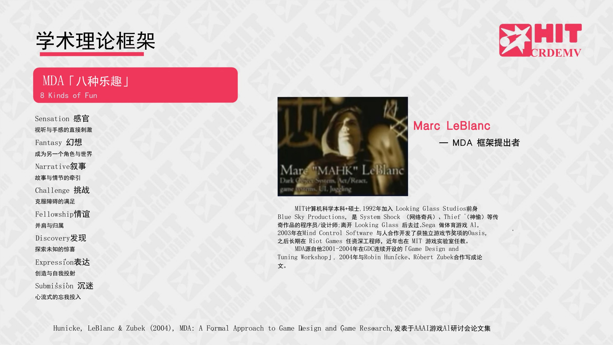

## 第 006 页 · Bartle 玩家类型

学术理论框架  
Bartle 玩家类型  
类型一体验映射  
成就者  
目标达成的满足  
探索者  
发现的惊喜  
社交者  
连接的温暖  
杀戮者  
支配的快感  
unilateral action 单方面行动  
Killers  
杀戮者  
players \<-  
玩家社交者  
Achievers  
成就者  
-一 world  
探索者 游戏世界  
Richard Bartle  
一玩家类型理论提出者  
Explorers  
Socializers  
横轴 （玩家一 游戏世界）：  
interaction  
互动  
玩家更关注与其他玩家互动（左），还是更关注游戏世界本身（右）  
英国埃塞克斯大学（University of Essex） 荣誉教授, "网络游戏教父"。  
1978年还是本科生时与 Roy Trubshaw 共同创造了世界上第一个 MUD （多用  
户地下城）,这被视为整个 MMORPG 品类的祖先。他的本科一等荣誉学位至今  
仍是埃塞克斯计算机系历史最高分之一,之后拿了人工智能博士学位并留校任教。  
1996年发表的Hearts, Clubs, Diamonds, Spades 被引超5000次,是游戏  
研究被引最高的论文之一;2003年出版 Designing Virtual Worlds 成为虚拟世  
界设计标准教材。2010年获首届 GDC 「Online Game Legend J 奖,斯坦福档  
案馆收藏有MUD1的全部设计手稿和源代码。  
纵轴 （单方面行动 - 互动）：  
玩家偏向自己对他人/世界施加行动（上），还是偏向与他人协作交流（下）  
Journal of MUD Research 1

[本页勘误／补录](core-experience-design-errata.md#page-006)。

[本页原始文字层](core-experience-design-source.md#page-006)

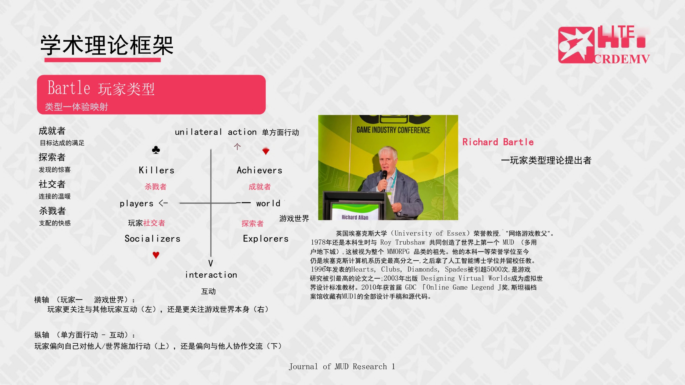

## 第 007 页 · 自我决定理论 SDT / PENS

学术理论框架 (LIE  
自我决定理论 (SDT / PENS) -体验的深层燃料  
胜任感我能做到  
自主感我自愿选择  
Edard Deci & Richard  
—自我决定理论(SDT)共同提出者  
归属感我属于这里  
所有好体验,本质都是这三种需求被满足的方式不同。  
左为 Deci, 右为 Ryan。  
两人都是罗切斯特大学(University of Rochester)心理学教授,1977 年相识,1981 年共同创立人类动  
机研究项目(Human Motivation Program),是心理学界最著名的终身合作搭档-----------Ryan称Deci是哦最好  
的朋友",两人互为学术上的"制衡"。  
Edward L. Deci (1942-2026)：本科数学(Hamilton College)、 MBA(沃顿)、卡内基梅隆社会心理  
学博士。1971年发表关于外在奖励会削弱内在动机的开创性实验,是SDT的起点。一生学术生涯都在罗切斯特  
大学，2017年以Gowen社会科学讲席教授荣退。2026年2月去世,享年83岁。业余还是缅因州  
Monhegan 岛艺术博物馆的馆长。  
Richard M. Ryan(1953- )：罗切斯特大学临床心理学博士，现任罗切斯特大学荣休教授、澳大利亚天  
主教大学积极心理学研究所研究教授。发表 450+ 篇论文，是全球被引最高的心理学家之一，获 APA 杰出科学  
贡献奖等多项终身成就奖。

[本页勘误／补录](core-experience-design-errata.md#page-007)。

[本页原始文字层](core-experience-design-source.md#page-007)

## 第 008 页 · 心流理论

学术理论框架  
心流理论 (Csikszentmihalyi)  
体验质量 = 挑战与能力的动态匹配。体验崩坏几乎都源于两端：太难(焦虑)或太简单(无聊)。  
太简单  
无聊  
挑战~能力  
心流通道  
大站住 八A比  
焦虑  
Mihaly Csikszentmihalyi  
一心流理论提出者  
(1934-2021)匈牙利裔美国心理学家，心流(flow)概念的创造者、积极心理学奠基人之一。  
生于意大利里耶卡(当时属意大利)，父亲是匈牙利外交官；二战期间曾被关进意大利拘留营,在营  
中学会下棋,发现高度专注能让人忘却周围苦难--这成为他后来研究"最佳体验"的原点。  
22岁移民美国，1965年获芝加哥大学博士，后长期任芝大心理系主任，晚年任克莱蒙特研究  
生大学(CGU)心理学与管理学杰出教授并创立生活质量研究中心。他研究过攀岩者、棋手、外科  
医生、舞者等各类人群,1990年Flow： The Psychology of Optimal Experience让"心流"进入  
大众语言:APA 前主席Martin Seligman 称他为"积极心理学领域世界领先的研究者，2021年  
10月去世。

[本页原始文字层](core-experience-design-source.md#page-008)

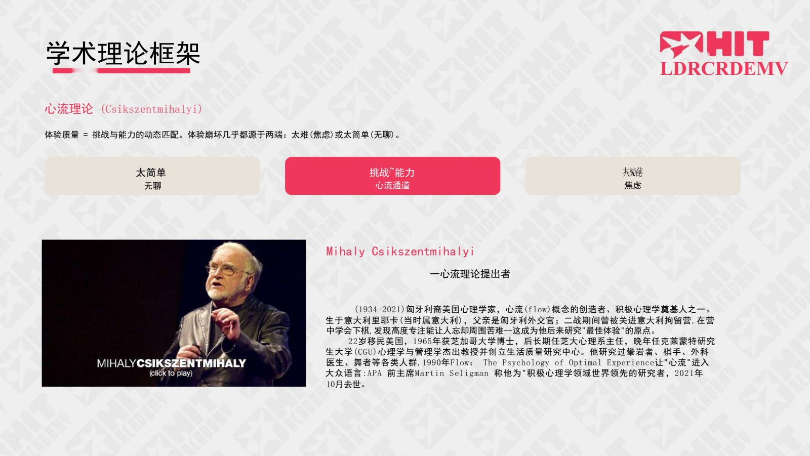

## 第 009 页 · SCI 沉浸模型

学术理论框架  
沉浸三层次 (Ermi & Mayra)  
感官沉浸  
画面、声音、操作反馈  
挑战沉浸  
机制本身让人忘我  
想象沉浸  
代入角色与世界  
Frans Mayra & Laura Ermi  
- sei沉浸三层次提出者  
左为Mayra,右为Ermi(后者是SCI论文一作，公开资料较少,这是她的个人主页照片)。  
Frans Mayra (1966-)：芬兰游戏研究的旗帜人物，坦佩雷大学(Tampere University)  
信息研究与交互媒体教授。本科是比较文学出身，博士论文研究'恶魔文本"--从文学转向游戏研究  
的路数很北欧。1990 年代初开始研究数字文化，2002 年创立坦佩雷游戏研究实验室(Game  
Research Lab)并任主任至今，主导过50+ 个研究项目、外部经费约640万欧元;是DiGRA  
(国际数字游戏研究协会)的创始人和首任主席，2016年入选 DiGRA 杰出学者；2018-2025年  
领导芬兰科学院资助的「游戏文化研究卓越中心」(CoE-GameCult)；2008 年出版的An  
Introduction to Game Studies 是游戏研究领域的标准教科书。他认为"游戏素养应当是每个人的核  
心素养"。  
Laura Ermi：芬兰坦佩雷大学研究者，Mayra 的学生与合作者。SCI 模型出自她 2005 年在  
DiGRA会议发表的论文(Ermi & Mayra 2005),该论文也是她被引最多的成果。

[本页原始文字层](core-experience-design-source.md#page-009)

## 第 010 页 · 体验谱系

体验谱系

[本页原始文字层](core-experience-design-source.md#page-010)

## 第 011 页 · 好奇心

体验谱系-好奇 HIT  
LDRCRDEHV  
好奇心谱系  
・ 知觉好奇「这看起来是什么?」（美术驱动探索）  
・ 认知好奇「为什么会这样?」（ Outer Wilds 式知识拼图）  
■ 情节好奇「接下来会怎样?」（剧情悬念）  
・ 社交好奇「那个人是谁?」 （NPC 与真人社交）  
■元好奇「这游戏藏了什么？」（彩蛋、 ARG 、打破第四面墙）  
《 Tunic 》

[本页勘误／补录](core-experience-design-errata.md#page-011)。

[本页原始文字层](core-experience-design-source.md#page-011)

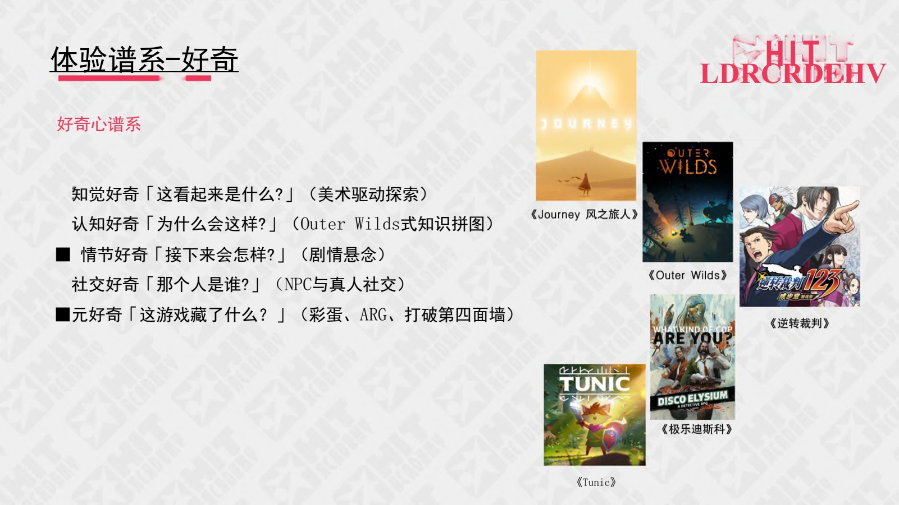

## 第 012 页 · 悬念

体验谱系-悬念  
悬念与不确定性  
・ 彩票式悬念:抽卡开箱,多巴胺的「差一点」  
・  竞技悬念:比分胶着,下一回合定生死  
・  恐怖悬念:转角处未知的东西  
■ 叙事悬念：罗生门式多视角真相  
■ 生存悬念：资源见底,下一个决定赌不赌  
《原神》  
miHoYo  
《街霸 6 》  
《寂静岭 2re 》  
《十三机兵防卫圈》

[本页勘误／补录](core-experience-design-errata.md#page-012)。

[本页原始文字层](core-experience-design-source.md#page-012)

## 第 013 页 · 敬畏与宏大

体验谱系-震【疑字／缺字：原 OCR 为 ^】  
敬畏与宏大 （Awe）  
■ 尺度震撼：太空俯瞰行星、巨物奇观（旺达与巨像）  
■ 时间震撼：文明跨越干年、【疑字／缺字：原 OCR 为 ^】海桑田  
■ 系统震撼：自己造的机器轰鸣运转（异星工厂）  
■ 美学震撼： GRIS 、风之旅人式的美术高潮  
«Gris»

[本页勘误／补录](core-experience-design-errata.md#page-013)。

[本页原始文字层](core-experience-design-source.md#page-013)

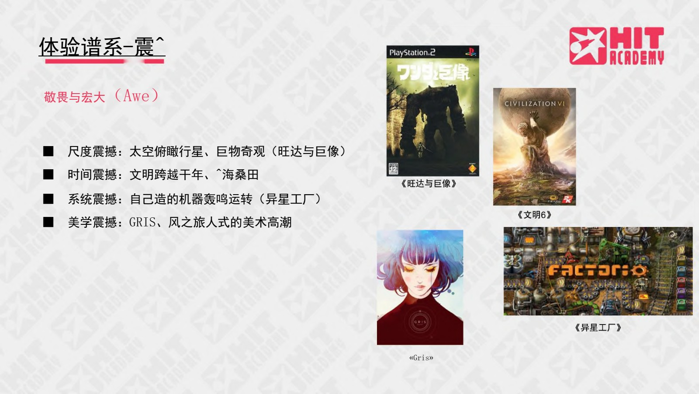

## 第 014 页 · 怀旧与时间

ME ITE  
怀旧与时间  
■ 复古体验：像素与 8-bit 音乐唤起的情感记忆  
・ 成长见证:宝可梦陪伴 20 年、存档里的小镇  
■ 季节体验：动森的时制与现实同步  
STARDEW  
YALLEY  
EHIT  
《星露谷物语》  
《宝可梦》  
传承体验：玩家遗物被陌生人继承（死亡搁浅式异步连接）  
《死亡搁浅》  
《集合啦！动物森友会》

[本页勘误／补录](core-experience-design-errata.md#page-014)。

[本页原始文字层](core-experience-design-source.md#page-014)

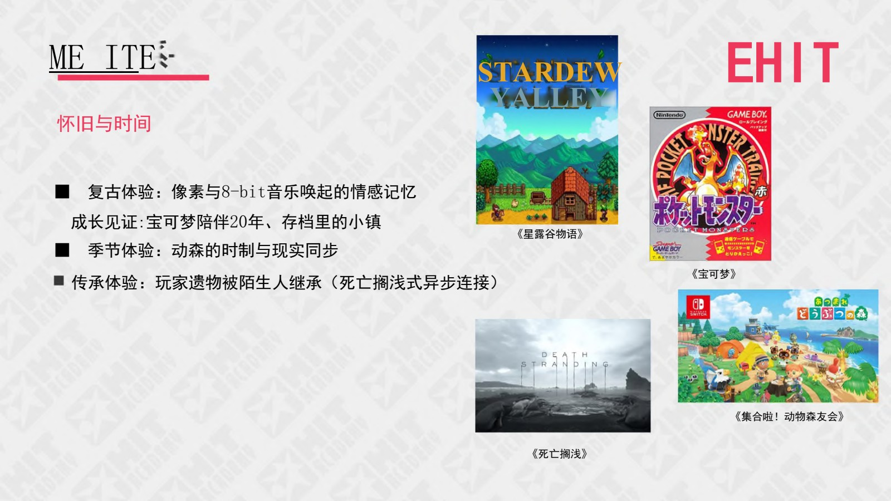

## 第 015 页 · 道德与负罪

体验谱系-负罪  
2MIT  
道德与负罪 (Dark Play)  
两难折磨：冰汽时代「这一切值得吗」  
背叛快感： GTA 的禁忌释放  
旁观者不适:请出示证件式「我只是执行命令」  
共情痛苦：这是我的战争、 Undertale 【疑字／缺字：原 OCR 为 ^】杀线一  
游戏惩罚你的暴力，不适感本身就是设计目的  
B  
《冰汽时代》  
《 GTA5 》  
《这是我的战争》  
ACEHst  
《请出示证件》

[本页勘误／补录](core-experience-design-errata.md#page-015)。

[本页原始文字层](core-experience-design-source.md#page-015)

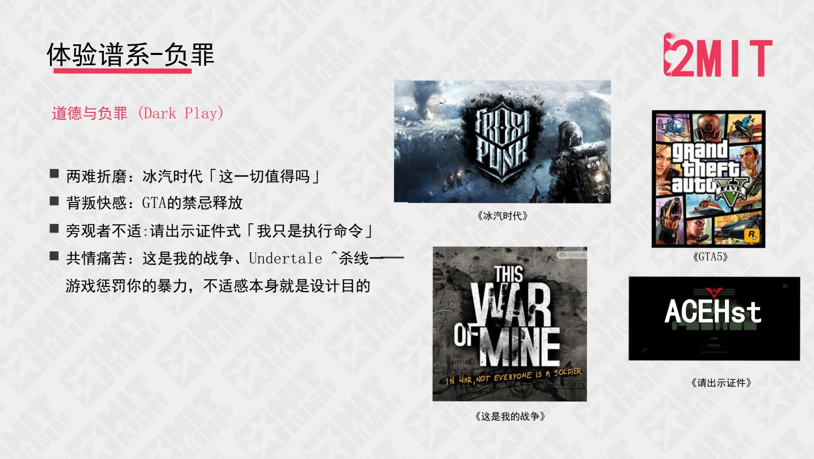

## 第 016 页 · 权力

体验谱系-权力  
@DVD  
操控与权力  
PE  
・  数值权力: 一刀 999  
■ 规则权力：修改物理规则（控制、传送门）  
■ 信息权力：全知视角 （策略游戏开图挂）  
・  社会权力: NPC 都听你的（模拟人生）  
■ 时间权力：逆转时间（死亡循环）  
■ 语言权力：对话改变世界规则（极乐迪斯科）  
DIABLO  
TV  
《暗黑破坏神》  
PORTAL  
K==  
CIUC  Gu D  
« 传送门 »  
DEATHLOOP"  
v 。  
« 模拟人生 4 》

[本页勘误／补录](core-experience-design-errata.md#page-016)。

[本页原始文字层](core-experience-design-source.md#page-016)

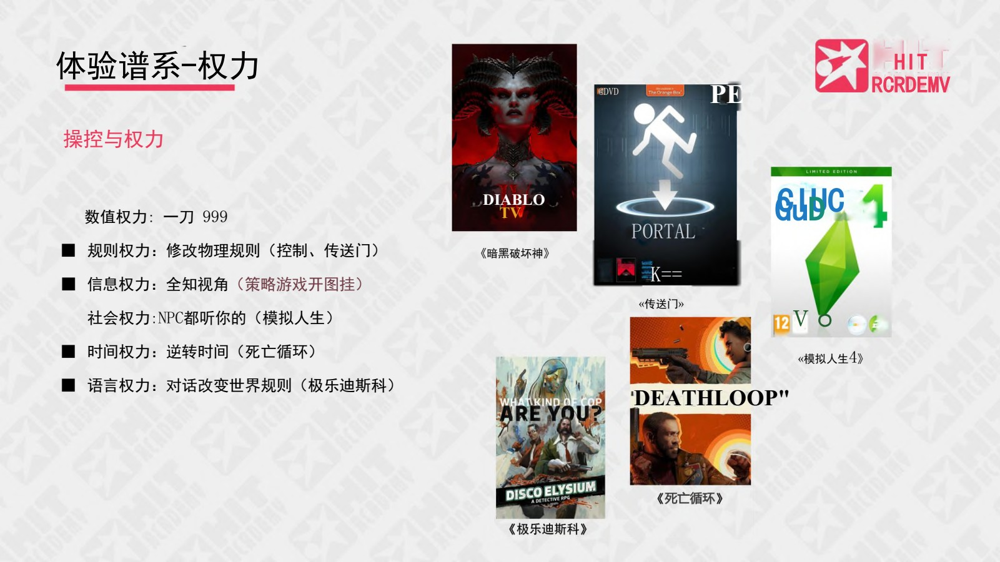

## 第 017 页 · 补偿

体验谱系-补偿  
补偿性体验  
・ 失败者补偿:现实受挫，游戏里称王  
■ 社交补偿：现实孤独,游戏里热闹  
■ 控制补偿：现实失控，游戏里一切可规划  
■ 身份补偿：现实平庸，游戏里独特（捏脸、皮肤）

[本页勘误／补录](core-experience-design-errata.md#page-017)。

[本页原始文字层](core-experience-design-source.md#page-017)

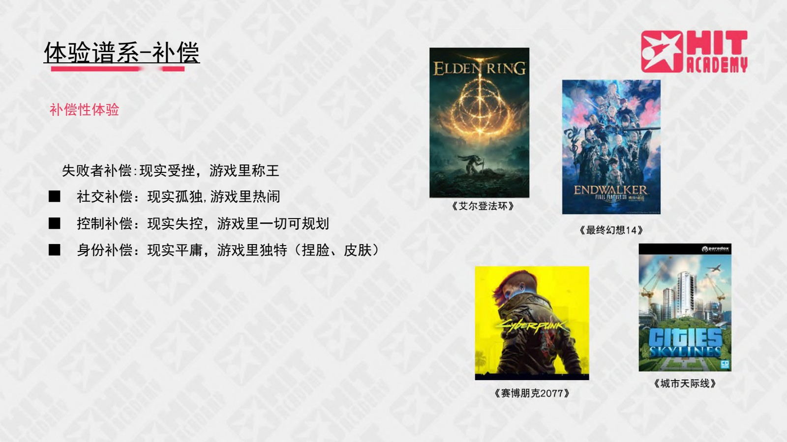

## 第 018 页 · 微小愉悦

体验谱系  
微小愉悦  
■ 手感体验：跳跃的弹性、枪械的后坐,取消后摇的顺滑  
■ 反馈体验：命中数字飘出、掉落光柱、开箱动画  
・ 拟音体验:踩雪声、开箱声、金币声（ASMR化设计）  
・  巧合惊喜:无心插柳触发的隐藏事件  
CD  
SWITCH.  
DEAD\*EELLS  
BEIION GBME DF THE YEBR  
《死亡细胞》  
《暗黑破坏神4》  
《塞尔达旷野之息》  
« Unpacking》

[本页勘误／补录](core-experience-design-errata.md#page-018)。

[本页原始文字层](core-experience-design-source.md#page-018)

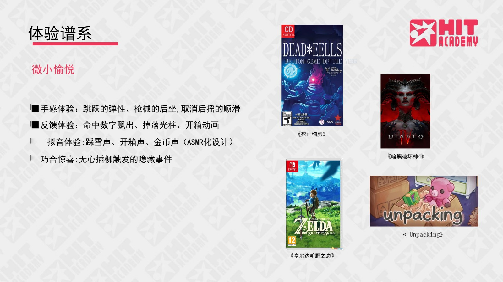

## 第 019 页 · 元游戏

体验谱系- Meta  
元游戏体验  
■看比玩爽：云玩家、直播体验（游戏作为内容）  
・ 研究体验:攻略、数据挖掘、理论构筑（游戏作为  
【疑字／缺字：原 OCR 为 ^】题）  
Crewmate  
《 Among Us 》  
« 流放之路 2»  
吃瓜体验：电竞赛事与游戏圈 drama  
制作体验： Mod 、二创、 Cosplay （游戏作为素材  
库）  
《 Minecraft 》  
《英雄联盟》

[本页勘误／补录](core-experience-design-errata.md#page-019)。

[本页原始文字层](core-experience-design-source.md#page-019)

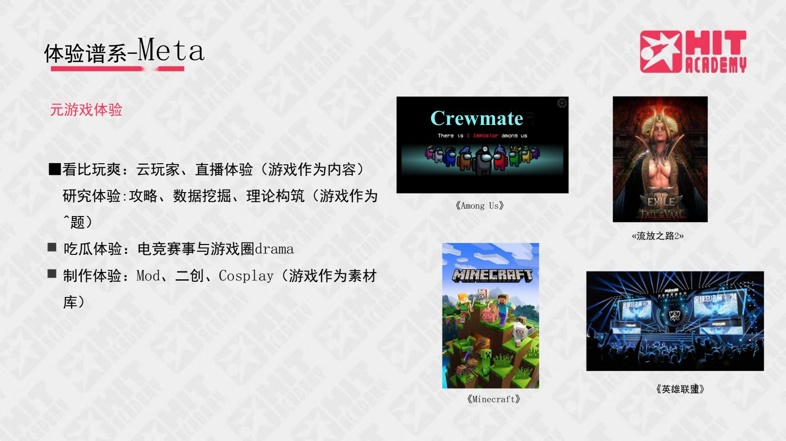

## 第 020 页 · 异步社交

体验谱系-异步  
异步社交  
■ 留言体验：黑魂的血迹留言、动森串门  
■ 影子体验：看到其他玩家的幻影与存档（死亡搁浅、  
风之旅人）  
■ 异步对抗：马里奥赛车的幽灵车、每日挑战排行  
榜一孤独但连接  
《马里奥赛车》  
3 RCRDEMV  
《死亡搁浅》

[本页勘误／补录](core-experience-design-errata.md#page-020)。

[本页原始文字层](core-experience-design-source.md#page-020)

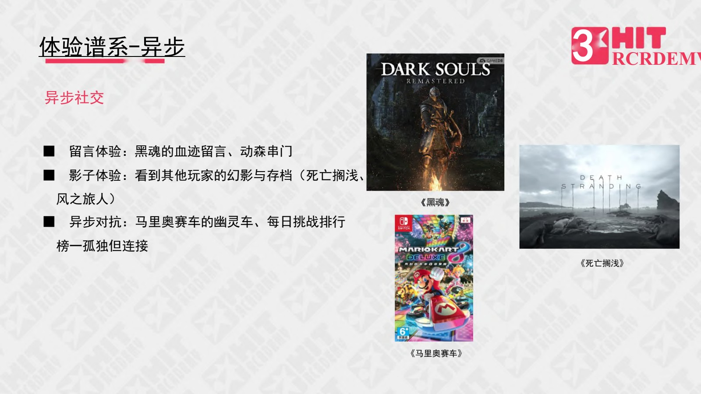

## 第 021 页 · 负体验分类

体验的反面：负体验分类 HIT  
设计时要知道自己在避免什么--甚至刻意利用什么  
负体验 产生原因 可被利用的方式  
挫败 难度断崖、输入延迟 魂系的「可克服的挫败」  
焦虑 时间压力、资源枯竭 恐怖游戏、生存游戏的核心燃料  
愧疚 道德选择 叙事游戏的情感深度  
错失恐惧 FOMO 限时活动 商业手段（慎用,易致burnout）  
虚无 刷刷刷后的空洞 尼尔这类游戏故意让你体验虚无来传达主题  
厌倦 内容重复、目标缺失 roguelike用随机性对冲

[本页原始文字层](core-experience-design-source.md#page-021)

## 第 022 页 · 体验循环

体验的「化学反应-体验循环 SMIT LADRCRDEMV  
体验循环 (Experience Loop) -几乎所有游戏的心跳  
战斗  
遭遇敌人一 击杀一 战利品一下一个敌人  
抽卡  
期待一开启一结果一再来一抽  
恐怖  
安全探索 一惊【疑字／缺字：原 OCR 为 ^】一喘息一继续探索

[本页勘误／补录](core-experience-design-errata.md#page-022)。

[本页原始文字层](core-experience-design-source.md#page-022)

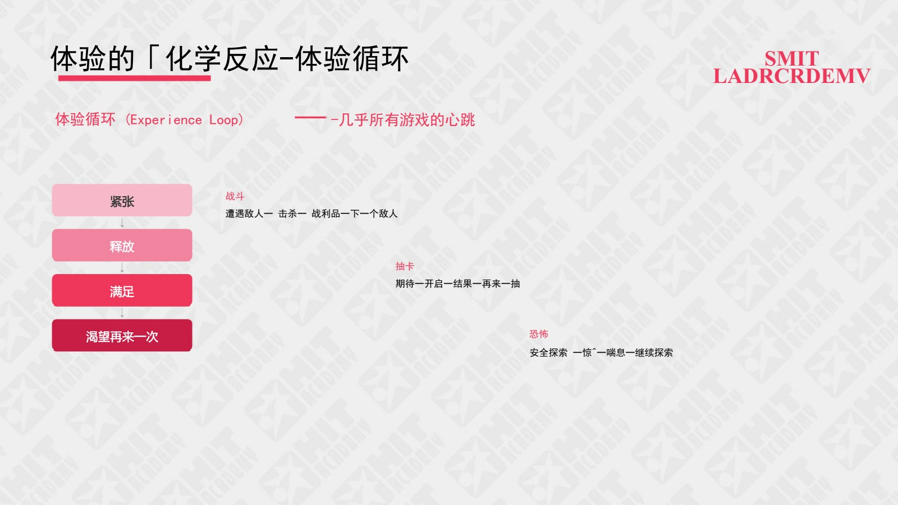

## 第 023 页 · 体验对比

S3HIT  
体验的「化学反应」  
体验对比 （Contrast 原理）  
高张力段落必须配合张力响息 一 恐怖游戏的「安全屋」  
I 给予之后的剥夺，比从未给予更痛一剧情杀  
夜越黑星越亮: 先压抑后爆发- FF7 爱丽丝、大镖客结局

[本页勘误／补录](core-experience-design-errata.md#page-023)。

[本页原始文字层](core-experience-design-source.md#page-023)

## 第 024 页 · 体验的纵向层次

体验的「化学反应」  
体验的纵向层次-同一时刻玩家在体验什么  
以《只狼》打弦一郎为例：  
表层 手感与节奏的爽（操作层）  
中层 我读懂了他的招式 （认知层）  
深层武士对决的仪式感、我不愿放弃（情感层）  
Tin  
底层 一次次失败后仍在坚持的我自己（自我叙事层）

[本页原始文字层](core-experience-design-source.md#page-024)

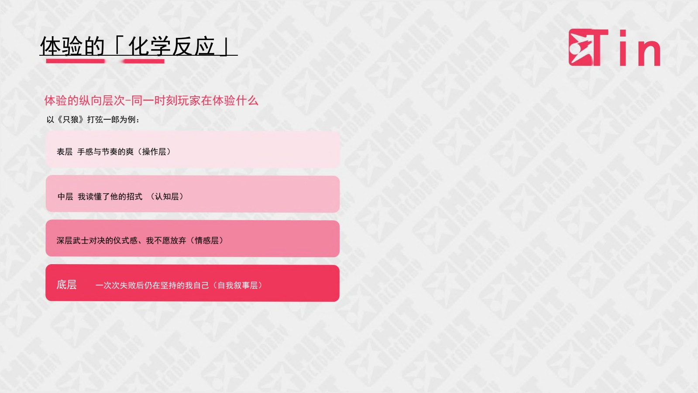

## 第 025 页 · 个体差异

体验的「化学反应」 HIT  
体验的个人差  
同一款游戏,不同玩家的体验完全不同：  
同一局【疑字／缺字：原 OCR 为 ^】人杀  
有人体验博弈快感，有人体验社交恐惧  
同一款魂系  
有人体验征服,有人体验折磨  
这解释了为什么「目标用户」必须先于「目标体验」定义。

[本页勘误／补录](core-experience-design-errata.md#page-025)。

[本页原始文字层](core-experience-design-source.md#page-025)

## 第 026 页 · 体验拆解

体验拆解

[本页原始文字层](core-experience-design-source.md#page-026)

## 第 027 页 · 挑战与心流 · 章节页

挑战体验

[本页原始文字层](core-experience-design-source.md#page-027)

## 第 028 页 · 挑战与心流 · 玩法类型

挑战与心流玩法类型  
克服困难后的成就感-"我变强了"  
核心玩法类型  
动作游戏 ・ 音游 ・ 高难度平台跳跃 ・ 弹幕射击，格斗游戏  
关键机制  
精确操作 • 节奏判定:死亡重来 • 阶段式 Boss 战 ・ 评分系统  
设计解析  
动作游戏要求玩家在高压环境下做出精准操作；  
音游考验节奏感与手眼协调；  
平台跳跃需要反复尝试找到正确路径。  
共同点是：失败成本极低（即刻重来）,成功需要肌肉记忆与策略理解的结合。  
避HERDERS  
黑暗之魂 3

[本页勘误／补录](core-experience-design-errata.md#page-028)。

[本页原始文字层](core-experience-design-source.md#page-028)

## 第 029 页 · 挑战与心流 · 考验能力

挑战与心流考验能力  
克服困难后的成就感-"我变强了"  
核心能力  
反应速度，模式学习能力,心态管理，抗挫折力 肌肉记忆  
认知要求  
观察敌人攻击前摇，记忆关卡布局，资源（血量/道具）管理  
能力解析  
初级玩家依赖反应；  
中级玩家学习模式；  
高级玩家追求最优解（速通/无伤）。  
死亡细胞  
心态管理尤为关键-- 能否将死亡重新定义为"信息获取"决定心流能否建立。  
哈迪斯

[本页原始文字层](core-experience-design-source.md#page-029)

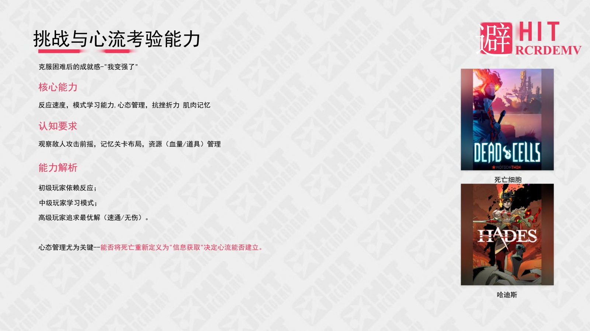

## 第 030 页 · 挑战与心流 · 主题

挑战与心流・ 主题  
克服困难后的成就感-"我变强了"  
常见题材  
黑暗奇幻・ 武士道・ 抽象极简・ 科幻机甲・ 神话史诗  
氛围关键词  
孤独感，压迫感，仪式感，肃杀感  
主题解析  
黑暗童话（空洞骑士）营造绝望中求生的心流  
复古卡通（茶杯头）强调一招一式的对决仪式感  
抽象风格（几何冲刺）剥离叙事，纯化挑战本身  
空洞骑士  
UPHEAD  
主题服务于"困难即美学"的核心体验。  
'DoNT DEALWITH  
THEDEVIL'  
茶杯头

[本页原始文字层](core-experience-design-source.md#page-030)

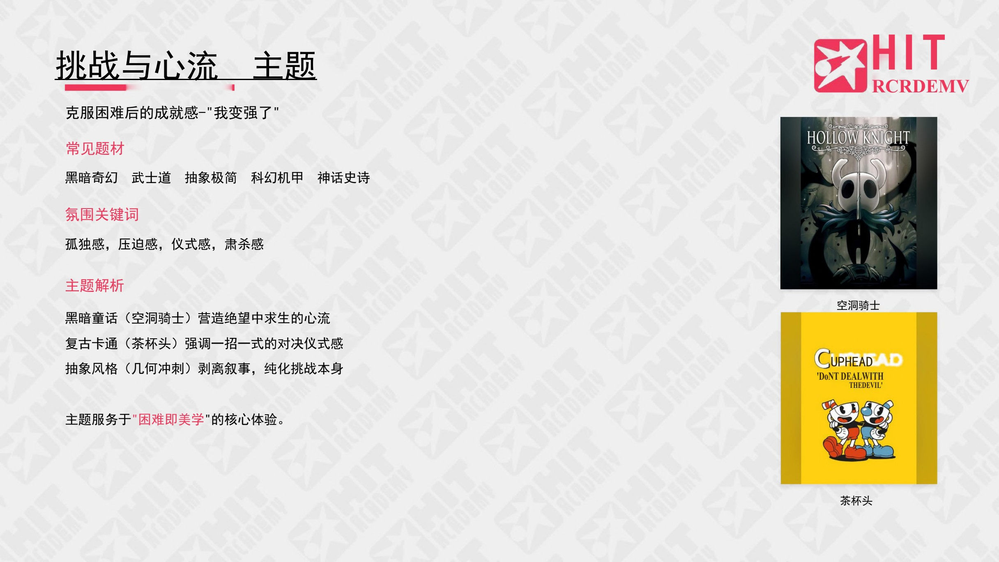

## 第 031 页 · 挑战与心流 · 体验循环

挑战与心流・ 体验循环  
克服困难后的成就感-"我变强了"  
大循环 探索区域分遭遇Boss 一 反复死亡分战胜Boss 一解锁新区域  
小时级以"一个Boss/一片区域"为单位,数小时完成一次"我不可能赢T我赢了"的成长弧线 0  
中循环 观察招式 一 尝试应对一死亡复盘一调整策略一 推进关卡  
分钟级 检查点之间的每一次尝试都是一局小考--失败成本极低,即刻重来 0  
小循环  
秒级  
读招 T 格挡/闪避 一 反击 一 处决  
秒级攻防交换是心流的发生地--肌肉记忆与节奏感的直接对话  
小循环嵌套中循环•中循环嵌套大循环-- 层层放大,循环往复

### 图示顺序转写

- 大循环：探索区域 → 遭遇 Boss → 反复死亡 → 战胜 Boss → 解锁新区域
- 中循环：观察招式 → 尝试应对 → 死亡复盘 → 调整策略 → 推进关卡
- 小循环：读招 → 格挡/闪避 → 反击 → 处决

[本页原始文字层](core-experience-design-source.md#page-031)

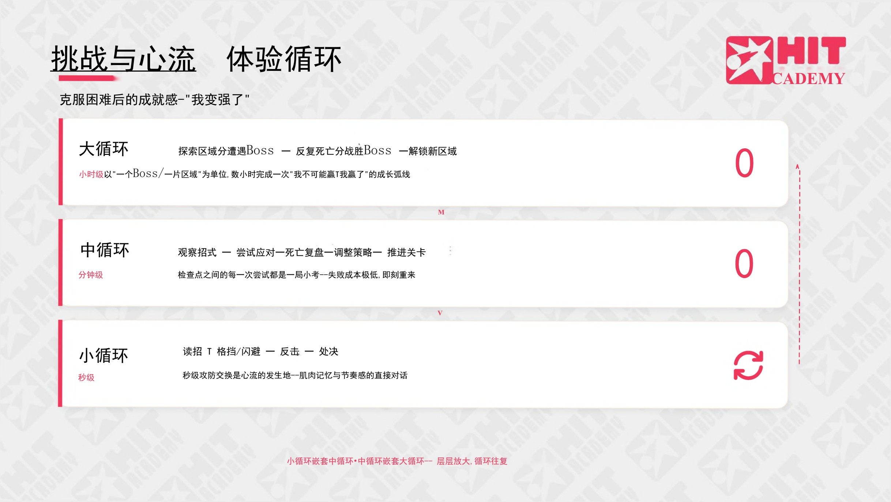

## 第 032 页 · 挑战与心流 · 对比原理

挑战与心流 ・ 对比原理  
克服困难后的成就感-"我变强了"  
核心原理  
失败的疼痛是胜利的造价  
公式类型  
蓄一放型：长时间蓄压（反复失败）一短暂爆发（通关瞬间）  
深度解析  
失败的痛苦与成功的狂喜形成强烈对比。  
若游戏太简单（无蓄压），胜利无感；若太难（无法释放）,玩家弃坑。  
心流的关键在于"刚好够不到的挑战"。  
怪物猎人：世界  
剥夺给予公式：先让玩家体验"拥有能力"（教程），再剥夺（正式挑战） ，最后归还（升级/熟练）。

[本页原始文字层](core-experience-design-source.md#page-032)

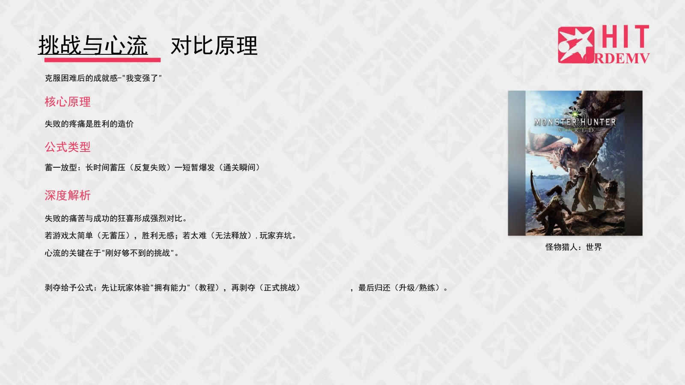

## 第 033 页 · 挑战与心流 · 纵向体验层次

【按原图四层对应关系重排；损坏层名不猜补】

| 层级 | 时间与阶段 | 原文说明 | 原文案例 |
|---|---|---|---|
| L1 感官层 | 即时吸引：0–30 秒 | 清脆的打击反馈与流畅动画，第一战就感到"手感对了" | 只狼、空洞骑士 |
| L2 行为层 | 上手投入：单次会话 | 熟悉敌人招式与关卡节奏，在死亡与重来之间逐步推进 | 死亡细胞、哈迪斯 |
| L3 情感层 | 持续沉浸：数日至数周 | 技巧肉眼可见地成长,曾经的强敌被轻松化解,进入心流状态 | 黑暗之魂3、怪物猎人：世界 |
| L4【层名缺损】 | 长期认同：数月以上 | "我变强了"成为自我认同,难度本身成为追求：无伤、速通、全成就 | 只狼、茶杯头 |

[本页原始文字层](core-experience-design-source.md#page-033)

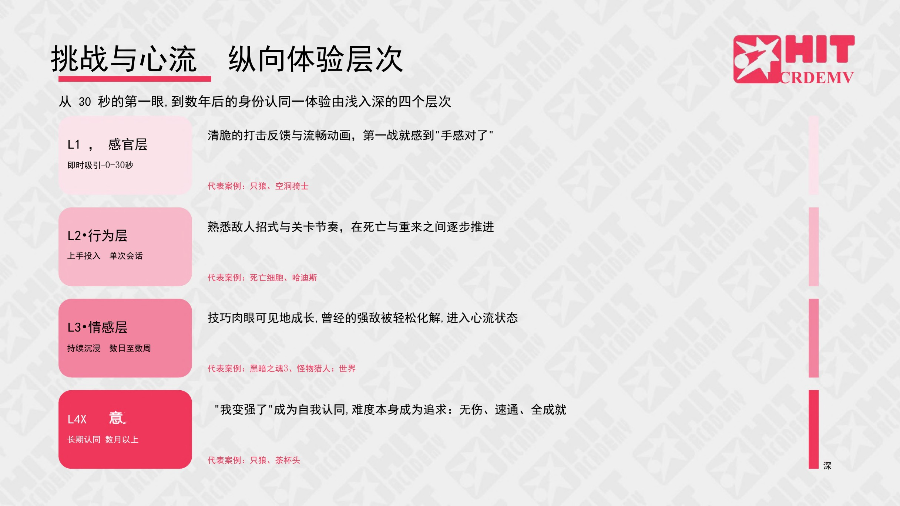

## 第 034 页 · 体验一致

体验一致

[本页原始文字层](core-experience-design-source.md#page-034)

## 第 035 页 · 叙事与情感 · 章节页

叙事体验

[本页原始文字层](core-experience-design-source.md#page-035)

## 第 036 页 · 叙事与情感 · 玩法类型

叙事与情感 ・ 玩法类型  
被故事打动--"我经历了这一切"  
核心玩法类型  
RPG ，互动电影，文字冒险，步行模拟，叙事解谜  
关键机制  
对话选择 •QTE •线索收集，分支叙事 ・ 情感计量  
设计解析  
RPG 通过长时长叙事建立情感连接;  
互动电影（底特律）用选择制造参与感；  
步行模拟（艾迪芬奇的记忆）用环境叙事替代战斗。  
最后生还者  
机制服务于叙事【疑字／缺字：原 OCR 为 ^】--玩家的每个操作都应该推动情感发展。  
荒野大镖客 2

[本页原始文字层](core-experience-design-source.md#page-036)

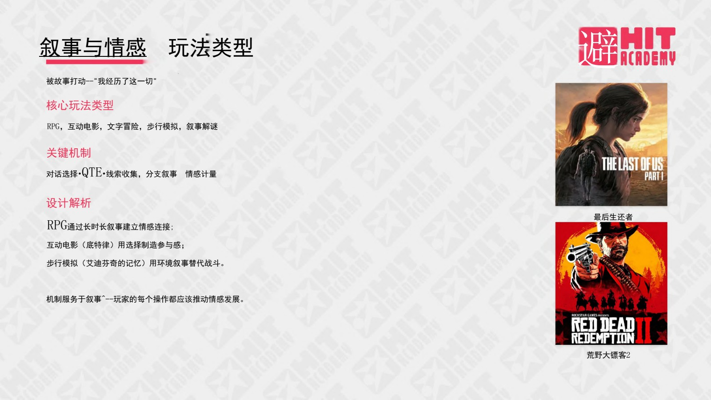

## 第 037 页 · 叙事与情感 · 主题

叙事与情感 ・ 主题  
被故事打动--"我经历了这一切"  
常见题材  
末日废土， Al 觉醒:西部黄昏，战争创伤 ・ 爱情回忆，反乌托邦  
氛围关键词  
melancholic ・ nostalgic - hopeful - tragic  
主题解析  
猎魔人史诗（巫师 3） 探讨人性底线；  
Al 觉醒（底特律）追问自由意志；  
互动电影（奇异人生）书写青春抉择的挽歌。  
主题是情感的放大器--相同的 Mechanics 换皮后情感体验完全不同。  
底特律：变人

[本页勘误／补录](core-experience-design-errata.md#page-037)。

[本页原始文字层](core-experience-design-source.md#page-037)

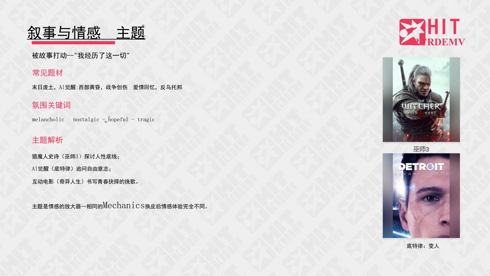

## 第 038 页 · 叙事与情感 · 考验能力

叙事与情感・ 考验能力  
被故事打动--"我经历了这一切"  
核心能力  
共情能力・ 道德判断・ 信息整合・ 细节观察，记忆回溯  
认知要求  
理解角色动机・ 预判剧情走向，解读隐喻符号  
能力解析  
高共情玩家会被角色的选择深深打动；  
喜欢分析的玩家会挖掘叙事结构。  
27  
LIFE・ STRANGE  
奇异人生  
叙事游戏考验的是"情感智商"--你能否理解角色的两难处境?  
去月球

[本页原始文字层](core-experience-design-source.md#page-038)

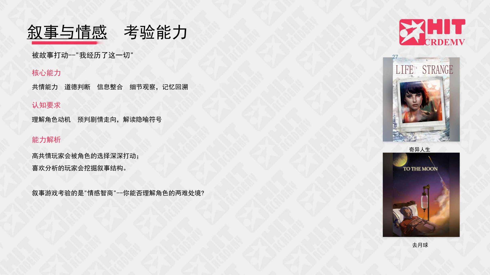

## 第 039 页 · 叙事与情感 · 体验循环

叙事与情感・ 体验循环 HIT  
被故事打动-- "我经历了这一切"  
大循环  
小时级  
章节展开一建立【疑字／缺字：原 OCR 为 ^】【疑字／缺字：原 OCR 为 ^】 一冲突爆发一情感高潮  
以"一个章节"为单位的情感弧线，数小时完成一次起承转合  
余韵沉淀  
中循环  
分钟级  
进入场景一对话/探索一收集信息一过场演出  
每个场景都是一段小型叙事,为最终的高潮蓄水  
情绪积累  
小活【疑字／缺字：原 OCR 为 ^】 拾取信件一端详物品一 选择对话一 触发反应  
秒级 轻操作、重阅读--秒级交互服务于"代入",而非"技巧"  
小循环嵌套中循环 层层放大,循环往复

### 图示顺序转写

- 大循环：章节展开 → 建立[原页缺损] → 冲突爆发 → 情感高潮 → 余韵沉淀
- 中循环：进入场景 → 对话/探索 → 收集信息 → 过场演出 → 情绪积累
- 小循环：拾取信件 → 端详物品 → 选择对话 → 触发反应

[本页勘误／补录](core-experience-design-errata.md#page-039)。

[本页原始文字层](core-experience-design-source.md#page-039)

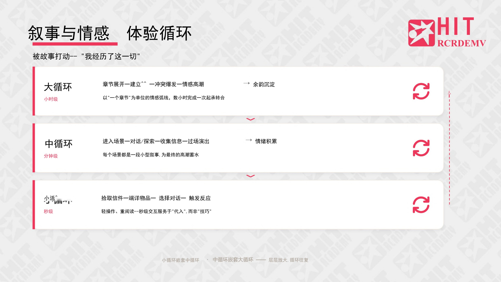

## 第 040 页 · 叙事与情感 · 对比原理

叙事与情感 ・ 对比原理  
被故事打动--"我经历了这一切"  
核心原理  
先建立再夺走最痛  
公式类型  
剥夺-给予型：建立情感连接一制造失去一余韵回荡  
深度解析  
叙事情感遵循"得而复失的公式。  
先让玩家爱上角色/世界（建立）,再制造冲突与失去（夺走），留下余韵。  
ORCHDENV  
极乐迪斯科  
缺席公式：重要的不是"发生了什么",而是"没发生什么"--那封没寄出的信、那句没说出口的话。

[本页原始文字层](core-experience-design-source.md#page-040)

## 第 041 页 · 叙事与情感 · 纵向体验层次

【按原图四层对应关系重排；损坏层名不猜补】

| 层级 | 时间与阶段 | 原文说明 | 原文案例 |
|---|---|---|---|
| L1【层名缺损】 | 即时吸引：0–30 秒 | 电影化演出与鲜活的角色登场,第一时间建立代入感 | 最后生还者、巫师3 |
| L2 行为层 | 上手投入：单次会话 | 通过对话与选择参与故事,亲手推动剧情走向 | 底特律：变人、奇异人生 |
| L3 情感层 | 持续沉浸：数日至数周 | 与角色建立情感羁绊,为虚拟人物的命运牵动心绪 | 荒野大镖客2、去月球 |
| L4【层名缺损】 | 长期认同：数月以上 | 故事沉淀为玩家的人生记忆,引发对现实的思考与共鸣 | 极乐迪斯科 |

[本页原始文字层](core-experience-design-source.md#page-041)

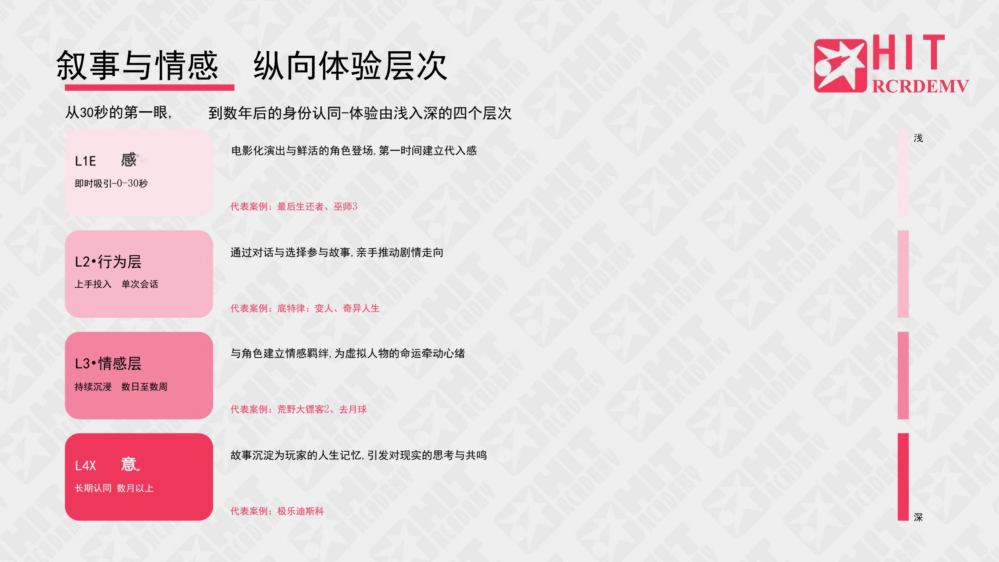

## 第 042 页 · 探索与发现 · 章节页

休系体【疑字／缺字：原 OCR 为 ^】

[本页原始文字层](core-experience-design-source.md#page-042)

## 第 043 页 · 探索与发现 · 玩法类型

探索与发现 ・ 玩法类型  
好奇心驱动--"前面有什么?"  
核心玩法类型  
开放世界 ・ 银河恶魔城，步行模拟，太空探索，解谜探索  
关键机制  
无标记导航 •环境线索 ・ 隐藏区域 ・ 渐进式地图解锁 •物理交互  
设计解析  
开放世界（塞尔达）用"看得见去不了"制造渴望;  
银河城（空洞骑士）用能力锁控制探索节奏;  
太空探索 （Outer Wilds） 用信息拼图驱动。  
核心机制是"好奇心一奖励一更强好奇心"的正循环。  
塞尔达：王国之泪

[本页勘误／补录](core-experience-design-errata.md#page-043)。

[本页原始文字层](core-experience-design-source.md#page-043)

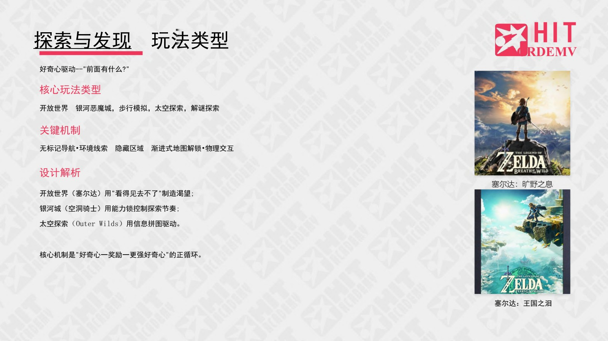

## 第 044 页 · 探索与发现 · 主题

探索与发现・ 主题  
好奇心驱动--"前面有什么?"  
常见题材  
奇幻王国・ 太空考古，神秘岛屿・ 深海未知•废墟文明  
氛围关键词  
wonder - mystery serenity - isolation  
主题解析  
异星海洋（深海迷航）满足童年探险梦；  
无限星系（无人深空）将探索升华为对宇宙的理解；  
神秘岛屿（见证者）用极简视觉制造纯粹好奇。  
主题定义了"值得探索的世界"--它必须有秘密,且秘密必须有意义。  
深海迷航  
无人深空

[本页原始文字层](core-experience-design-source.md#page-044)

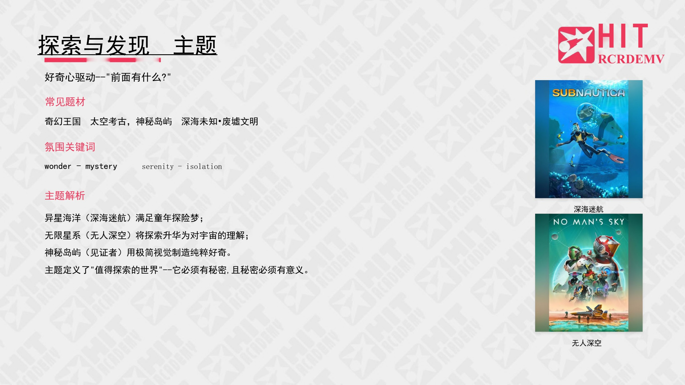

## 第 045 页 · 探索与发现 · 考验能力

探索与发现 ・ 考验能力  
好奇心驱动--"前面有什么?"  
核心能力  
观察力，空间思维，系统实验，联想能力，耐心  
认知要求  
注意非常规细节 ・ 理解环境叙事建立地图心理模型  
能力解析  
探索型玩家擅长"注意到不对劲"--为什么这里有个裂缝？  
为什么 NPC 反复说这句话？  
空间思维帮助在复杂地图中定位；  
系统实验精神驱动"如果我用火烧这个会怎样？"  
TUNIC  
光明旅者

[本页原始文字层](core-experience-design-source.md#page-045)

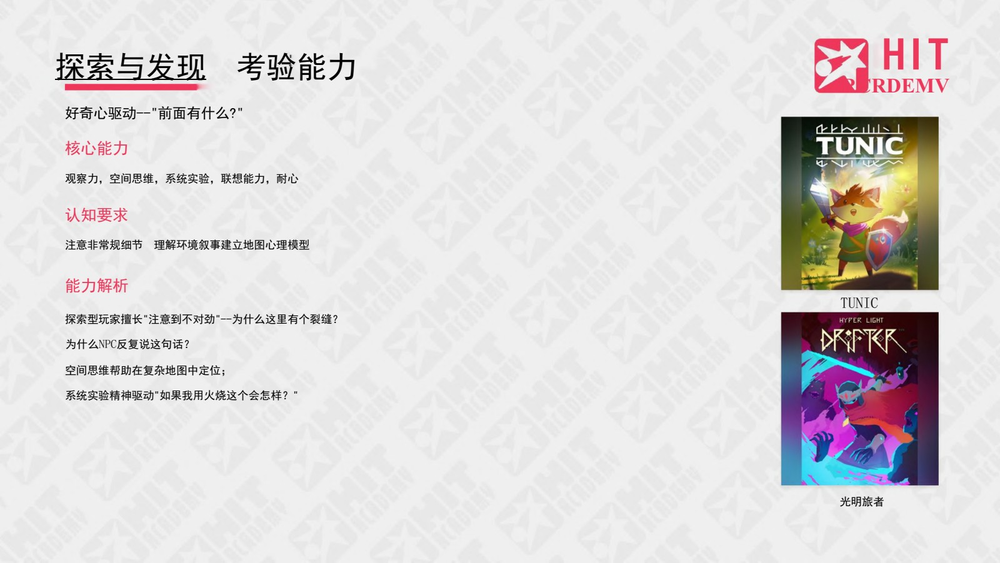

## 第 046 页 · 探索与发现 · 体验循环

探索与发现・ 体验循环 HIT  
好奇心驱动-- "前面有什么?"  
十活玉 眺望目标一 规划路线 T 长途跋涉 一 抵达发现一 解锁新区域  
小时级 以"一片区域"为单位的探索节奏，地图上不断亮起新的兴趣点 C  
中循环  
分钟级  
注意到异常一好奇靠近7解谜/攀爬一获得奖励一标记新目标  
"那座塔后面有什么?" 每个兴趣点就是一次中循环  
小循环  
秒级  
【疑字／缺字：原 OCR 为 ^】爬滑翔一战斗一环境互动  
移动本身就是乐趣--手感与物理反馈让"赶路"不枯燥

### 图示顺序转写

- 大循环：眺望目标 → 规划路线 → 长途跋涉 → 抵达发现 → 解锁新区域
- 中循环：注意到异常 → 好奇靠近 → 解谜/攀爬 → 获得奖励 → 标记新目标
- 小循环：[原页缺字]爬/滑翔 → 战斗 → 环境互动

[本页原始文字层](core-experience-design-source.md#page-046)

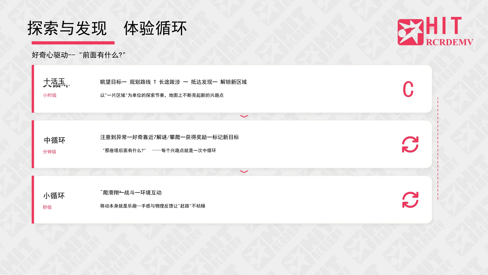

## 第 047 页 · 探索与发现 · 对比原理

探索与发现 ・ 对比原理  
好奇心驱动--"前面有什么?"  
核心原理  
"自己找到的' vs" 被告诉的"价值差  
公式类型  
缺席型：未知（好奇）一已知（满足）一新的未知  
深度解析  
探索的价值来自"发现的自主性"。  
被任务标记指引去 A 点,与自己偶然发现 A 点,情感价值天壤之别。  
好的探索设计制造"信息缺口"--玩家知道有东西但不知道是什么。  
英灵神殿  
99% 的已知+ 1% 的未知=最大的探索驱动力。

[本页原始文字层](core-experience-design-source.md#page-047)

## 第 048 页 · 探索与发现 · 纵向体验层次

【按原图四层对应关系重排；损坏层名不猜补】

| 层级 | 时间与阶段 | 原文说明 | 原文案例 |
|---|---|---|---|
| L1【层名缺损】 | 即时吸引：0–30 秒 | 开阔世界与远处的奇观，唤起"我想去看看"的本能冲动 | 塞尔达：旷野之息 |
| L2 行为层 | 上手投入：单次会话 | 自由移动与环境互动,每个角落都可能藏着惊喜 | 深海迷航、英灵神殿 |
| L3 情感层 | 持续沉浸：数日至数周 | 拼凑世界观碎片，画出"我的地图",收获独家发现 | 塞尔达：王国之泪、TUNIC |
| L4【层名缺损】 | 长期认同：数月以上 | 探索内化为本能,玩家成为世界的见证者与讲述者 | 光明旅者、无人深空 |

[本页原始文字层](core-experience-design-source.md#page-048)

## 第 049 页 · 掌控与成长 · 章节页

成长体验

[本页原始文字层](core-experience-design-source.md#page-049)

## 第 050 页 · 掌控与成长 · 玩法类型

掌控与成长，玩法类型 HIT  
从弱到强-"我看着自己成了传奇"  
核心玩法类型  
ARPG刷宝・ 卡牌构筑，数值养成自动化生产城市建设  
关键机制  
Loot掉落・ Build 搭配•数值膨胀・ 科技树・ 产量优化  
设计解析  
ARPG（暗黑破坏神）用装备掉落制造多巴胺；  
卡牌构筑（杀戮尖塔）用牌组synergy考验策略;  
自动化（异星工厂）用效率提升带来掌控感。  
b.  
DIABLO  
暗黑破坏神4  
Oaythe pire  
共同点是:投入时间一看到数值/效率提升一获得正反馈。  
杀戮尖塔

[本页勘误／补录](core-experience-design-errata.md#page-050)。

[本页原始文字层](core-experience-design-source.md#page-050)

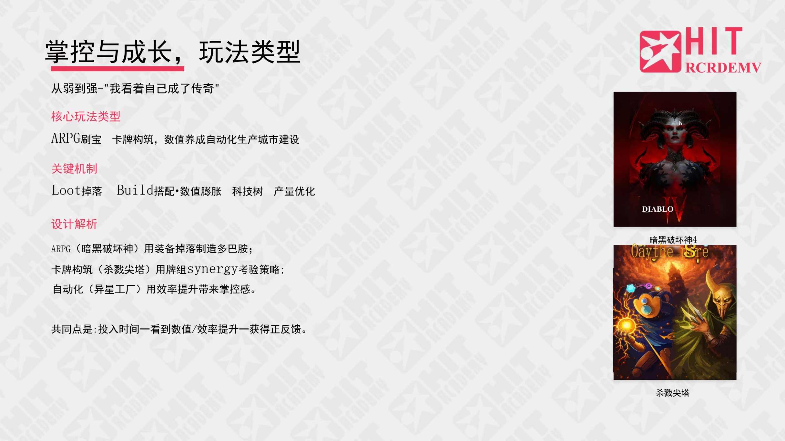

## 第 051 页 · 掌控与成长 · 主题

掌控与成长，主题  
从弱到强-"我看着自己成了传奇"  
常见题材  
黑暗魔幻，科幻未来 ・ 文明史诗末日废土异星殖民  
氛围关键词  
powerful - industrious - ambitious - satisfying  
主题解析  
黑暗魔幻（流放之路）中的英雄从菜鸟到毁灭者  
弹幕生存（吸血鬼幸存者）中从被围猎到清屏无双。  
主题提供了"成长的叙事包装"--玩家不仅在提升数字,也在书写一部崛起史诗。  
吸血鬼幸存者

[本页勘误／补录](core-experience-design-errata.md#page-051)。

[本页原始文字层](core-experience-design-source.md#page-051)

## 第 052 页 · 掌控与成长 · 考验能力

掌控与成长.考验能力  
从弱到强-"我看着自己成了传奇"  
核心能力  
长期规划，资源管理，概率计算 ・ 系统优化,决策权衡  
认知要求  
Build 数值模拟 ・ 投入产出分析 ・ 路径依赖预判  
能力解析  
刷宝玩家精通概率论--知道什么难度掉落性价比最高;  
策略玩家擅长长期规划--"先点这个科技, 30 回合后爆发"。  
成长型玩家享受"延迟满足"--为了后期的强大,愿意忍受前期的弱小。  
神界:原罪 2  
女神异闻录 5

[本页原始文字层](core-experience-design-source.md#page-052)

## 第 053 页 · 掌控与成长 · 体验循环

掌控与成长.体验循环  
从弱到强-"我看着自己成了传奇"  
大循环  
小时级  
刷图刷本 一获得装备/卡牌 一验证Build 一挑战更高难度  
以"一次Farm" 为单位,数值与构筑螺旋上升  
中循环  
分钟级  
一场战斗一掉落鉴定一词条比较一构筑调整  
每次掉落都是一次"我变强了吗"的即时检验  
小循环 走位 技能循环一爆发窗口一 资源管理  
秒级 技能CD与资源条构成的秒级节奏,是Build的手感落点

### 图示顺序转写

- 大循环：刷图刷本 → 获得装备/卡牌 → 验证 Build → 挑战更高难度
- 中循环：一场战斗 → 掉落鉴定 → 词条比较 → 构筑调整
- 小循环：走位 → 技能循环 → 爆发窗口 → 资源管理

[本页原始文字层](core-experience-design-source.md#page-053)

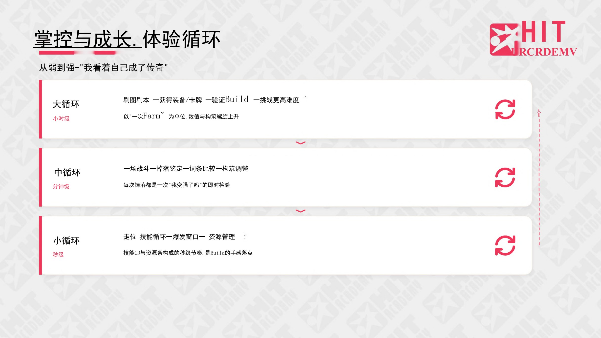

## 第 054 页 · 掌控与成长 · 对比原理

掌控与成长对比原理  
从弱到强-"我看着自己成了传奇"  
核心原理  
开局必须弱,先剥夺后给予  
公式类型  
剥夺-给予型：弱小（剥夺）7积累（努力）-强大（给予）  
深度解析  
成长的核心对比是"现在的自己" vs" 过去的自己"。  
如果开局即满级,成长感荡然无存。  
"先剥夺后给予"公式：游戏先让你体验限制（没有技能、装备差） ，再通过努力逐步解锁能力。  
这种"失而复得"比"一直拥有"更有价值。  
Ui=  
赛博朋克 2077

[本页原始文字层](core-experience-design-source.md#page-054)

## 第 055 页 · 掌控与成长 · 纵向体验层次

【按原图四层对应关系重排；损坏层名不猜补】

| 层级 | 时间与阶段 | 原文说明 | 原文案例 |
|---|---|---|---|
| L1【层名缺损】 | 即时吸引：0–30 秒 | 掉宝光柱与伤害数字跳动,即时奖励直击多巴胺 | 暗黑破坏神4、吸血鬼幸存者 |
| L2 行为层 | 上手投入：单次会话 | 搭配Build与装备词条,感受数值与策略的双重成长 | 流放之路、女神异闻录5 |
| L3 情感层 | 持续沉浸：数日至数周 | 从抄作业到自创流派,掌控系统规则的成就感拉满 | 杀戮尖塔、神界：原罪2 |
| L4【层名缺损】 | 长期认同：数月以上 | 角色成为玩家的作品与化身,长期经营产生深厚投入 | 赛博朋克2077 |

[本页原始文字层](core-experience-design-source.md#page-055)

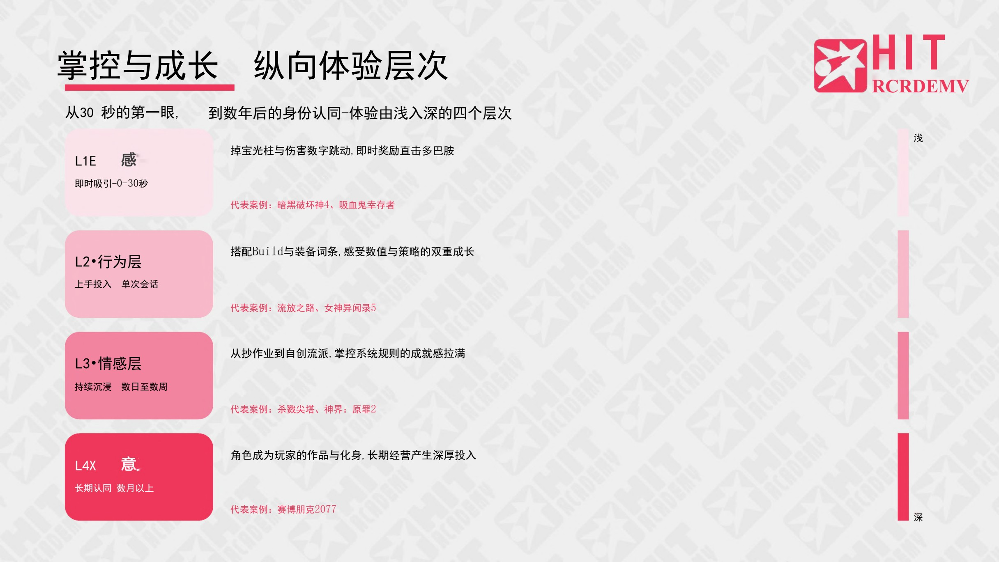

## 第 056 页 · 创造与表达 · 章节页

人:INμ||一八 创造体验

[本页原始文字层](core-experience-design-source.md#page-056)

## 第 057 页 · 创造与表达 · 玩法类型

创造与表达 ・ 玩法类型  
无中生有--"这是我做的'  
核心玩法类型  
沙盒建造，物理沙盒 ・ 自动化 ・ 关卡设计，涂装设计  
关键机制  
方块放置 •物理模拟 ・ 蓝图系统 •零件组装，分享上传  
设计解析  
沙盒（泰拉瑞亚）提供无限方块与自由；  
物理沙盒（围攻）用零件组合创造战争机器；  
自动化（戴森球计划）用传送带编织工业网络。  
创造游戏的核心是"从 0到 1"-- 给予工具,不设目标,让玩家定义成功。

[本页勘误／补录](core-experience-design-errata.md#page-057)。

[本页原始文字层](core-experience-design-source.md#page-057)

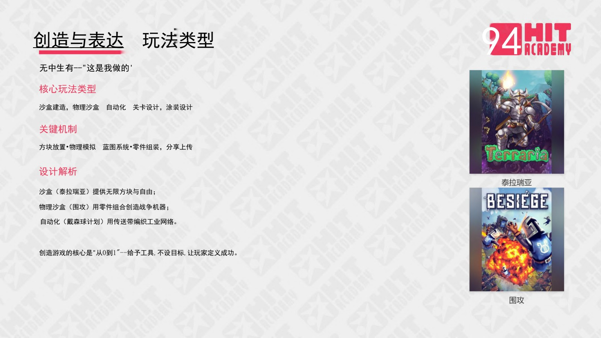

## 第 058 页 · 创造与表达 · 主题

创造与表达，主题  
无中生有--"这是我做的'  
常见题材  
自动化工厂,异星殖民 ・ 理想家园，物理攻城，太空工程  
氛围关键词  
creative peaceful - satisfying proud  
主题解析  
自 动 化 （ 异 星 工 厂 ） 剥 离 冗 余 操 作 ， 只 剩 效 率 美 学 ; 星 际 工 业 （ 戴 森 球 计 划 ） 将 创 造 升 华 为 文 明 建 设 。 创 造  
类游戏的主题往往极简--没有反派,没有紧迫威胁，只有"你想造什么?"  
戴森球计划  
异星工厂

[本页原始文字层](core-experience-design-source.md#page-058)

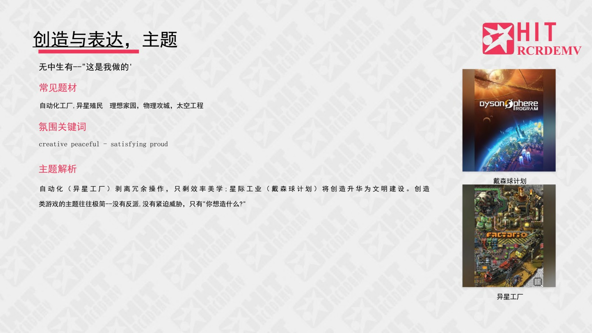

## 第 059 页 · 创造与表达 · 考验能力

创造与表达，考验能力  
无中生有--"这是我做的'  
核心能力  
空间想象力 •工程规划，审美品味 ・ 系统思维，迭代优化  
认知要求  
3D 结构规划,功能与美观平衡 ・ 模块化设计  
能力解析  
建筑师型玩家擅长空间规划与美学；  
工程师型玩家追求效率最优；  
艺术家型玩家用方块/零件创作像素画/雕塑。  
创造游戏考验的是"将想象转化为现实"的能力--脑中有一个画面,然后一步步实现它。  
城市：天际线  
幸福工厂

[本页原始文字层](core-experience-design-source.md#page-059)

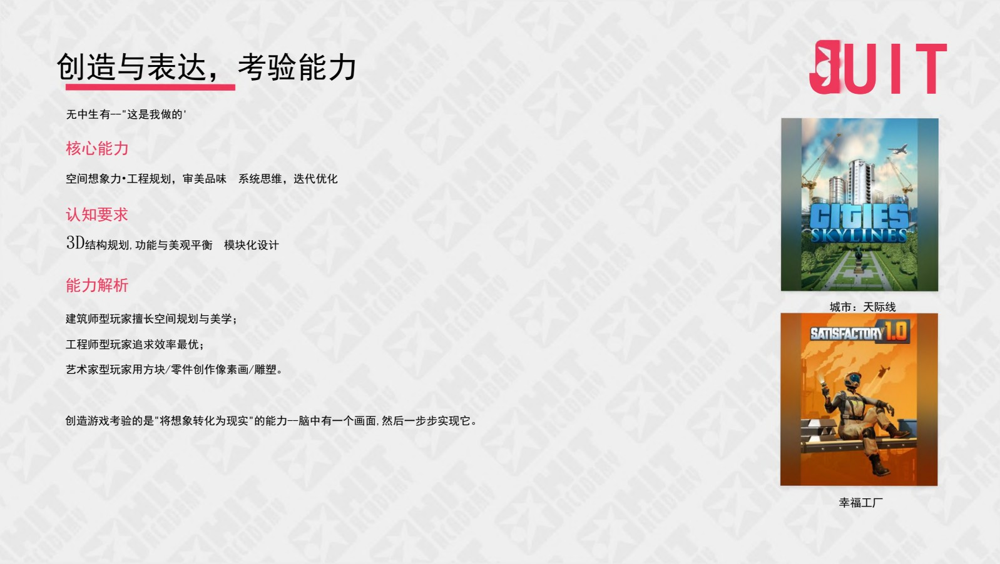

## 第 060 页 · 创造与表达 · 体验循环

创造与表达・ 体验循环 HIT  
无中生有-- "这是我做的"  
大循环  
小时级  
构思蓝图一采集材料一 动工建造一展示分享一【疑字／缺字：原 OCR 为 ^】代翻新  
以"一个作品"为单位的创作周期--从灵感到落成  
R 个  
中循环  
分钟级  
搭一个结构一退后审视一拆改调整一逐渐成型  
创作在"做一看一改"的往复中，螺旋逼近想象  
小循环  
秒级  
放置一拆除一拖【疑字／缺字：原 OCR 为 ^】旋转  
操作必须零门槛--创造的手感就是"所想即所得" R  
小循环嵌套中循环•中循环嵌套大循环 层层放大,循环往复

### 图示顺序转写

- 大循环：构思蓝图 → 采集材料 → 动工建造 → 展示分享 → [原页缺字]代翻新
- 中循环：搭一个结构 → 退后审视 → 拆改调整 → 逐渐成型
- 小循环：放置 → 拆除 → 拖[原页缺字]旋转

[本页原始文字层](core-experience-design-source.md#page-060)

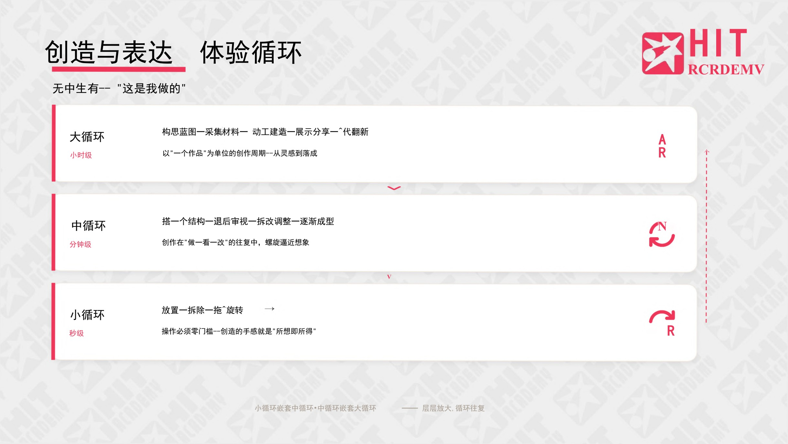

## 第 061 页 · 创造与表达 · 对比原理

创造与表达 ・ 对比原理  
无中生有--"这是我做的'  
核心原理  
限制即风格  
公式类型  
蓄一放型：限制（框架）一创造（释放）一作品  
深度解析  
创造的快感来自"在限制中表达"。  
没有限制（无限资源）反而让创造失去意义；  
恰到好处的限制（方块种类有限、零件有物理约束）激发创造力。  
坎巴拉太空计划  
对比公式:"空白的画布"（焦虑） vS" 有约束的画布"（激发）。好游戏给框架,不给答案。

[本页原始文字层](core-experience-design-source.md#page-061)

## 第 062 页 · 创造与表达 · 纵向体验层次

【按原图四层对应关系重排；损坏层名不猜补】

| 层级 | 时间与阶段 | 原文说明 | 原文案例 |
|---|---|---|---|
| L1 感官层 | 即时吸引：0–30 秒 | 放下第一个方块与零件,想法立刻在眼前成形 | 泰拉瑞亚、围攻 |
| L2 行为层 | 上手投入：单次会话 | 解决一个个工程难题,让庞大系统运转起来 | 异星工厂、幸福工厂 |
| L3 情感层 | 持续沉浸：数日至数周 | 优化与扩张,自动化流水线带来"秩序之美"的满足 | 戴森球计划、城市：天际线 |
| L4【层名缺损】 | 长期认同：数月以上 | 作品即自我表达,分享创造赢得社区认可 | 坎巴拉太空计划 |

[本页原始文字层](core-experience-design-source.md#page-062)

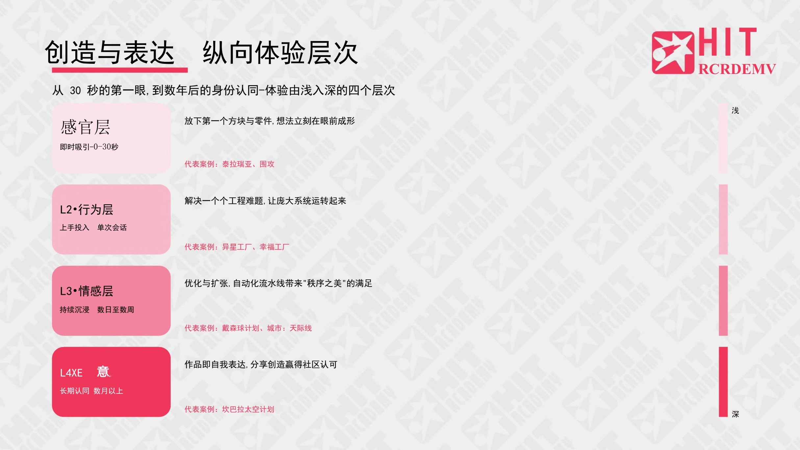

## 第 063 页 · 社交与归属 · 章节页

社交体验

[本页原始文字层](core-experience-design-source.md#page-063)

## 第 064 页 · 社交与归属 · 玩法类型

社交与归属 ・ 玩法类型  
与人连接--"我们是一伙的"  
核心玩法类型  
合作闯关 ・ 派对游戏， MMO ，社交模拟 ・ 团队竞技  
关键机制  
分工协作，语音沟通 ・ 公会系统 • 礼物交换，表情互动  
设计解析  
合作闯关（双人成行）强制分工,缺一不可;  
派对游戏（鹅鸭杀）用身份猜忌制造社交张力；  
MMO （魔兽世界）用公会/团队副本建立长期关系。  
社交游戏的核心是"人与人之间的化学反应,--机制只是催化剂。  
胡闹厨房 2

[本页勘误／补录](core-experience-design-errata.md#page-064)。

[本页原始文字层](core-experience-design-source.md#page-064)

## 第 065 页 · 社交与归属 · 主题

社交与归属主题  
与人连接--"我们是一伙的"  
常见题材  
冒险团队,公会家园 ・ 节日派对末日共存虚拟社区  
氛围关键词  
温暖的，闹哄哄的，怀旧的，归属感  
主题解析  
闯关综艺（糖豆人）用淘汰制造欢笑；  
太空狼人杀 （Among Us） 用猜疑点燃聚会;  
公会家园（魔兽世界）是玩家的"第二故乡"。  
社交游戏的主题是"在一起"--不管做什么,重要的是和谁一起做。  
糖豆人  
Among Us

[本页原始文字层](core-experience-design-source.md#page-065)

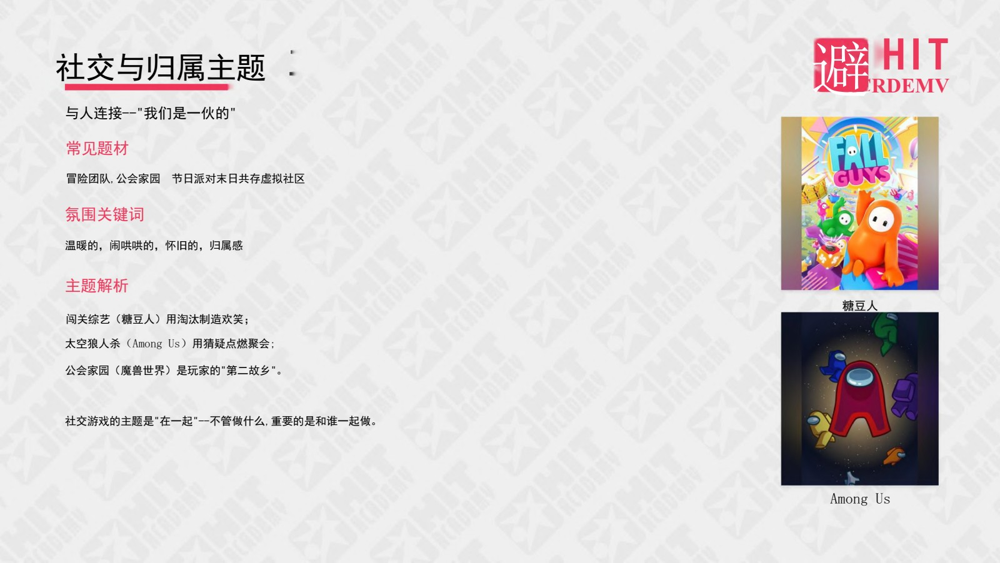

## 第 066 页 · 社交与归属 · 考验能力

社交与归属，考验能力  
与人连接--"我们是一伙的"  
核心能力  
沟通能力、分工协作，读人，领导力，情绪管理  
认知要求  
理解队友意图 ・ 协调冲突，分配任务  
能力解析  
社交游戏的胜负往往不取决于个人技术,而取决于团队配合。  
好的队友能互补短板;  
坏的队友即使个人技术强也会拖累团队。  
读人能力--判断队友是想要指导还是需要鼓励--决定社交体验的质量。  
PHASMOPHORIA  
恐鬼症  
深岩银河

[本页原始文字层](core-experience-design-source.md#page-066)

## 第 067 页 · 社交与归属 · 体验循环

社交与归属・ 体验循环  
与人连接-- "我们是一伙的"  
士活环 组队开黑一分工【疑字／缺字：原 OCR 为 ^】关一翻盘/翻车—互相调侃  
小时级 以"一次开黑"为单位,输赢都会转化为共同记忆  
约下一把  
中循环  
分钟级  
沟通分工一各就各位一协同执行7救场/甩锅  
每个关卡都是一次小型团队演练  
小循环 呼喊传递一接应一同步操作  
秒级 、、快把洋葱给我！"--秒级协作制造密集的笑点与默契

### 图示顺序转写

- 大循环：组队开黑 → 分工[原页缺字]关 → 翻盘/翻车 → 互相调侃 → 约下一把
- 中循环：沟通分工 → 各就各位 → 协同执行 → 救场/甩锅
- 小循环：呼喊传递 → 接应 → 同步操作

[本页原始文字层](core-experience-design-source.md#page-067)

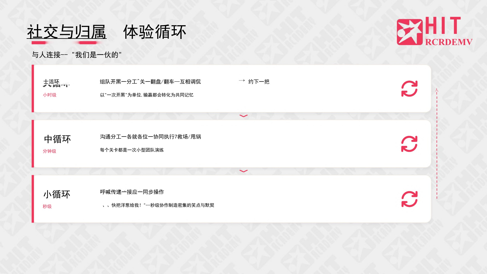

## 第 068 页 · 社交与归属 · 对比原理

社交与归属 ・ 对比原理  
与人连接--"我们是一伙的"  
核心原理  
孤独衬托并肩的温暖  
公式类型  
缺席型：孤独（基线）T并肩（对比）一归属  
深度解析  
社交体验的价值来自"从孤独到连接"。  
单人游玩时的孤独感成为基线，与人合作时的温暖感由此凸显。  
对比公式：先让玩家体验到一个人做不到"（需要合作开门/击败 Boss） 再给予"一起做到"的满足感。  
胡闹搬家  
没有孤独的对比,社交的甜蜜会被稀释。

[本页原始文字层](core-experience-design-source.md#page-068)

## 第 069 页 · 社交与归属 · 纵向体验层次

【按原图四层对应关系重排；损坏层名不猜补】

| 层级 | 时间与阶段 | 原文说明 | 原文案例 |
|---|---|---|---|
| L1【层名缺损】 | 即时吸引：0–30 秒 | 和朋友连麦开黑的欢笑,第一时间点燃气氛 | 糖豆人、Among Us |
| L2 行为层 | 上手投入：单次会话 | 分工配合完成目标,在混乱中磨合出团队默契 | 双人成行、胡闹厨房2 |
| L3 情感层 | 持续沉浸：数日至数周 | 共同经历的糗事与高光，沉淀为朋友间的梗与回忆 | 恐鬼症、胡闹搬家 |
| L4【层名缺损】 | 长期认同：数月以上 | 游戏成为社交纽带："一起玩"比"玩什么"更重要 | 深岩银河 |

[本页原始文字层](core-experience-design-source.md#page-069)

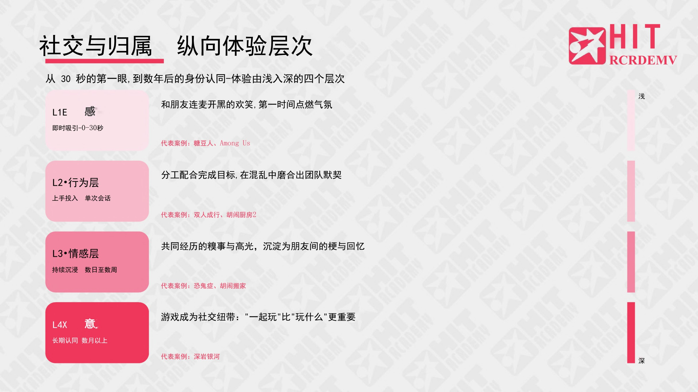

## 第 070 页 · 刺激与释放 · 章节页

刺激体验

[本页原始文字层](core-experience-design-source.md#page-070)

## 第 071 页 · 刺激与释放 · 玩法类型

刺激与释放 ・ 玩法类型  
情绪宣泄--蓄压越久,爆发越爽  
核心玩法类型  
无双割草 ・ 恐怖生存，竞速， VR 体感，快节奏射击  
关键机制  
连击系统 • Jump Scare • 氮气加速 • 体感挥砍 ・ 爆头判定  
设计解析  
无双割草（毁灭战士）用持续击杀制造爽快感；  
恐怖游戏（逃生）用紧张积累-惊吓释放制造心跳；  
竞速（地平线）用速度感刺激多巴胺。  
刺激游戏的核心是"情绪曲线管理"--蓄压与释放的节奏把控。  
生化危机 4

[本页勘误／补录](core-experience-design-errata.md#page-071)。

[本页原始文字层](core-experience-design-source.md#page-071)

## 第 072 页 · 刺激与释放 · 主题

刺激与释放 ・ 主题 RENDEMY  
情绪宣泄--蓄压越久,爆发越爽  
常见题材  
地狱入侵 •丧尸末日 ・ 恶魔围城 ・ 未来竞速 •光剑音律  
氛围关键词  
紧绷的，肾上腺素的，恐惧的，令人战栗狂喜的  
主题解析  
神话史诗（战神）让玩家成为弑神之父；  
华丽处刑（猎天使魔女）把连击跳成芭蕾；  
光剑音律 （Beat Saber） 将音乐转化为肢体释放。  
战神  
主题是情绪的燃料-血腥满足攻击欲，恐怖满足受虐后的解脱感。  
猎天使魔女

[本页原始文字层](core-experience-design-source.md#page-072)

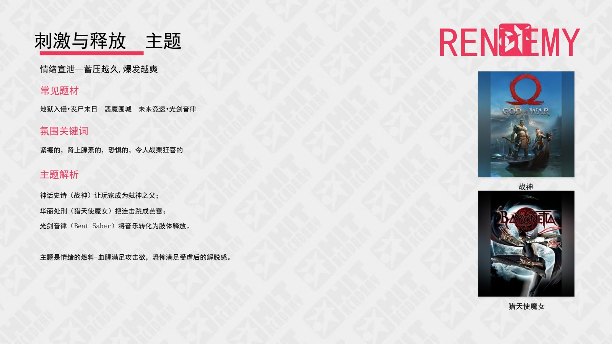

## 第 073 页 · 刺激与释放 · 考验能力

刺激与释放考验能力  
情绪宣泄--蓄压越久,爆发越爽  
核心能力  
反应速度 ・ 时机判断，路线规划，心理承压，肢体协调  
认知要求  
快速决策 ・ 风险评估 •节奏把控  
能力解析  
刺激游戏考验的是"在压力下保持冷静"。  
恐怖游戏中，慌了就会操作变形；  
竞速游戏中，急躁就会撞车。  
死亡循环  
高手与菜鸟的区别不在于反应速度,而在于压力下的决策质量。  
英雄萨姆 4

[本页原始文字层](core-experience-design-source.md#page-073)

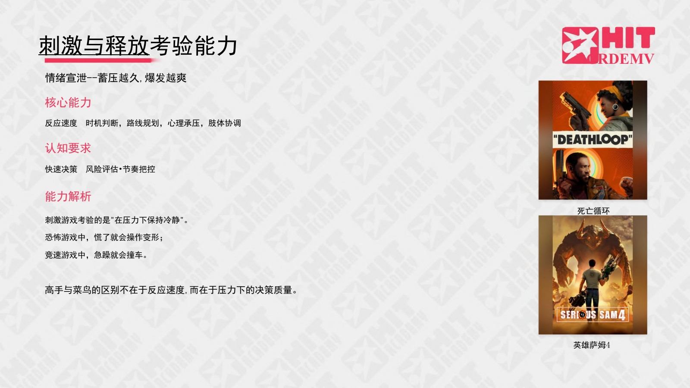

## 第 074 页 · 刺激与释放 · 体验循环

刺激与释放・ 体验循环  
情绪宣泄--蓄压越久,爆发越爽  
大活环 压力累积一战斗升级一火力全开一短暂喘息WET  
小时级 以"一个关卡"为单位的蓄压一释放波形，张弛必须交替  
中循环 接敌7倾泻火力一处决收尾一搜刮补给  
分钟级 一场遭遇战就是一次完整的 、、压力一宣泄"脉冲  
小循环 暗准 一 射击 一 闪避 一 换弹 一 处决  
再上强度  
秒级 秒级对抗的密度决定心率--刺激靠"反应",不靠"思考"

### 图示顺序转写

- 大循环：压力累积 → 战斗升级 → 火力全开 → 短暂喘息 → 再上强度
- 中循环：接敌 → 倾泻火力 → 处决收尾 → 搜刮补给
- 小循环：瞄准 → 射击 → 闪避 → 换弹 → 处决

[本页勘误／补录](core-experience-design-errata.md#page-074)。

[本页原始文字层](core-experience-design-source.md#page-074)

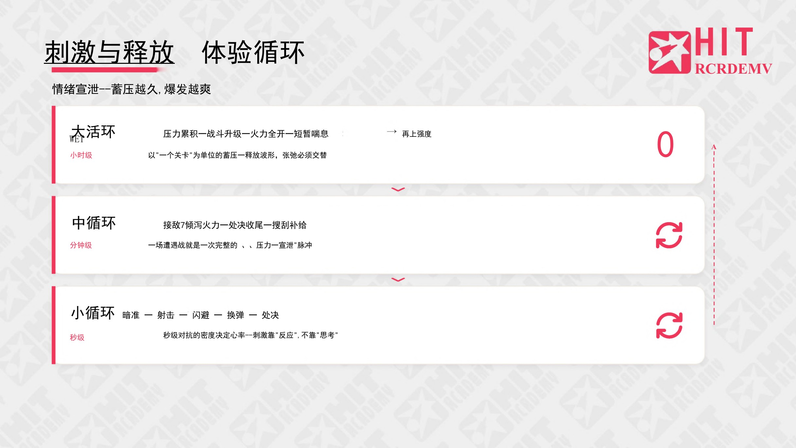

## 第 075 页 · 刺激与释放 · 对比原理

刺激与释放对比原理  
情绪宣泄--蓄压越久,爆发越爽  
核心原理  
蓄压时长决定爆发威力  
公式类型  
蓄一放型：蓄压（紧张积累）7引爆（惊吓/胜利）-宣泄（释放）  
深度解析  
刺激体验遵循"张力-释放"模型。  
恐怖游戏用寂静蓄压, Jump Scare 释放;  
动作游戏用低血量蓄压，反杀释放。  
关键公式：爆发爽感=蓄压强度X蓄压时长。没有蓄压的释放（一直爽）会迅速麻木。  
Hi-Fi RUSH

[本页原始文字层](core-experience-design-source.md#page-075)

## 第 076 页 · 刺激与释放 · 纵向体验层次

【按原图四层对应关系重排；损坏层名不猜补】

| 层级 | 时间与阶段 | 原文说明 | 原文案例 |
|---|---|---|---|
| L1【层名缺损】 | 即时吸引：0–30 秒 | 火爆演出与强劲音效,瞬间拉高肾上腺素 | 毁灭战士：永恒、英雄萨姆4 |
| L2 行为层 | 上手投入：单次会话 | 高强度战斗中保持操作,释放压力与攻击性 | 生化危机4、战神 |
| L3 情感层 | 持续沉浸：数日至数周 | 掌握连招与节奏后,暴力美学升华为”战斗的舞蹈" | 猎天使魔女、HI-FI RUSH |
| L4【层名缺损】 | 长期认同：数月以上 | 畅快淋漓的宣泄成为情绪调节阀，回味无穷 | 死亡循环 |

[本页原始文字层](core-experience-design-source.md#page-076)

## 第 077 页 · 放松与治愈 · 章节页

放松体验

[本页原始文字层](core-experience-design-source.md#page-077)

## 第 078 页 · 放松与治愈 · 玩法类型

放松与治愈 ・ 玩法类型  
无压力的日子-"生活可以这么慢"  
核心玩法类型  
生活模拟，农场经营，放置游戏，整理解谜，禅意游戏  
关键机制  
无失败惩罚 •实时流逝 ・ 自动化收益自由摆放 ・ 无目标引导  
设计解析  
农场经营(星露谷)用季节循环代替关卡；  
放置游戏用离线收益制造惊喜；  
整理解谜 (Unpacking) 用收纳满足秩序欲。  
94 HIT  
治愈游戏的核心是"无威胁"-没有失败,没有敌人,没有时间压力。  
Unpacking

[本页勘误／补录](core-experience-design-errata.md#page-078)。

[本页原始文字层](core-experience-design-source.md#page-078)

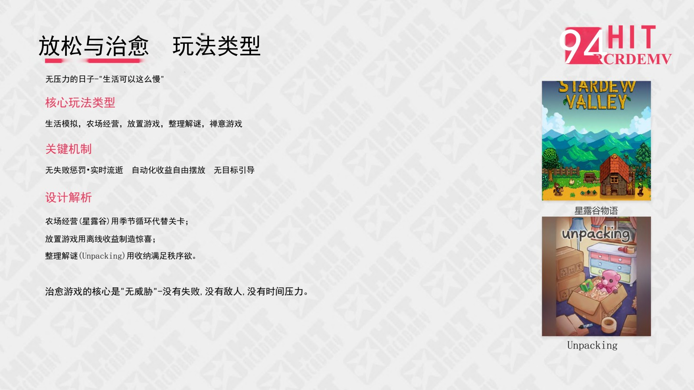

## 第 079 页 · 放松与治愈 · 主题

放松与治愈 ・ 主题  
无压力的日子-"生活可以这么慢"  
常见题材  
田园小岛，乡村生活，搬家人生，水墨禅意 ・ 海底世界  
氛围关键词  
平静的 ・ 安逸的 ・ 怀旧的 •忧郁的  
主题解析  
牧场（史莱姆牧场）逃离都市焦虑；  
鬼镇（和睦森林）用善意安抚幽灵；  
禅意（风之旅人）用沙漠与音符净化心灵。  
避 HIT  
史莱姆牧场  
COZY【疑字／缺字：原 OCR 为 ^】GROVE  
治愈游戏的主题是"另一个节奏"-与现实的急促形成对比的慢世界。  
和睦森林

[本页原始文字层](core-experience-design-source.md#page-079)

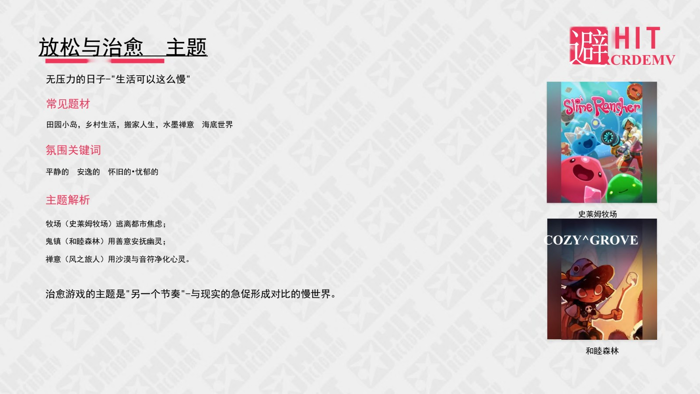

## 第 080 页 · 放松与治愈 · 考验能力

放松与治愈 ・ 考验能力  
无压力的日子-"生活可以这么慢"  
核心能力  
轻规划,审美品味 ・ 耐心 ・ 情绪调节  
认知要求  
空间整理，资源轻管理 ・ 季节计划  
能力解析  
治愈游戏刻意"不考验"--不考验反应,不考验策略深度。  
它考验的是"你能不能慢下来"。  
玩家需要的不是技巧,而是心态一愿意在没有目标的世界中闲逛。  
短途徒步  
筑梦水乡

[本页原始文字层](core-experience-design-source.md#page-080)

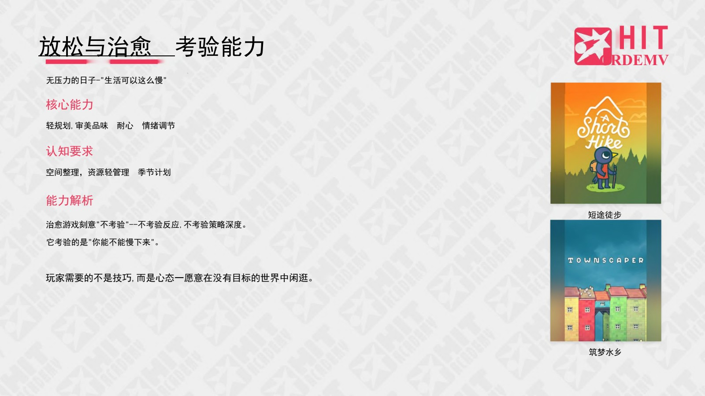

## 第 081 页 · 放松与治愈 · 体验循环

放松与治愈・ 体验循环  
无压力的日子- "生活可以这么慢"  
迎着晨光起床—。做今天想做的事—。伴着夜色休息  
以"游戏里的一天"为单位--没有失败,只有节奏  
大循环  
小时级  
中循环  
分钟级  
0 个  
小循环  
秒级  
浇一片田一【疑字／缺字：原 OCR 为 ^】一条鱼一拆一个箱子一,摆一件家具  
每件小事都 、、做得完"--确定性本身就是治愈  
点击分 拖拽T轻音效7小动画  
秒级反馈柔和圆润 没有一个像素在催促你

### 图示顺序转写

- 大循环：迎着晨光起床 → 做今天想做的事 → 伴着夜色休息
- 中循环：浇一片田 → [原页缺字]一条鱼 → 拆一个箱子 → 摆一件家具
- 小循环：点击 → 拖拽 → 轻音效 → 小动画

[本页原始文字层](core-experience-design-source.md#page-081)

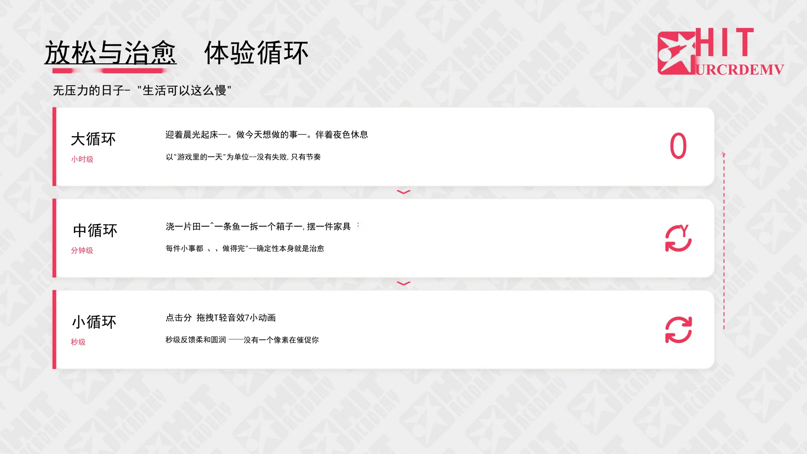

## 第 082 页 · 放松与治愈 · 对比原理

放松与治愈 ・ 对比原理  
无压力的日子-"生活可以这么慢"  
核心原理  
与现实的 KPI 对比  
公式类型  
缺席型：现实压力（基线）一游戏无压（对比）一治愈  
深度解析  
治愈体验的价值来自与现实生活的对比。  
现实中的 KPI 、 deadline 、社交压力成为基线, 游戏中外故什么都可以旧勺自由由此凸显。  
GRIS  
对比公式：治愈感=现实压力强度 x 游戏释放程度。没有现实焦虑的玩家,很难理解治愈游戏的魅力。

[本页原始文字层](core-experience-design-source.md#page-082)

## 第 083 页 · 放松与治愈 · 纵向体验层次

【按原图四层对应关系重排；损坏层名不猜补】

| 层级 | 时间与阶段 | 原文说明 | 原文案例 |
|---|---|---|---|
| L1 感官层 | 即时吸引：0–30 秒 | 柔和的画面与音乐,第一眼就感到平静 | 星露谷物语、Unpacking |
| L2 行为层 | 上手投入：单次会话 | 无压力的节奏里种田、整理物品,进入低唤醒状态 | 史莱姆牧场、筑梦水乡 |
| L3 情感层 | 持续沉浸：数日至数周 | 日常仪式感的陪伴,游戏成为情绪避风港 | 和睦森林、短途徒步 |
| L4【层名缺损】 | 长期认同：数月以上 | 治愈感迁移到现实生活,成为自我关怀的习惯 | GRIS |

[本页勘误／补录](core-experience-design-errata.md#page-083)。

[本页原始文字层](core-experience-design-source.md#page-083)

## 第 084 页 · 幻想与身份 · 章节页

幻想体验

[本页原始文字层](core-experience-design-source.md#page-084)

## 第 085 页 · 幻想与身份 · 玩法类型

幻想与身份 ・ 玩法类型  
成为不可能成为的人--第二人生  
核心玩法类型  
人生模拟 ・ 开放世界犯罪 ・ MMO 角色扮演，虚拟社交  
关键机制  
角色创建 ・ 职业系统 ・ 道德值 ・ 声望系统 ・ 换装系统  
设计解析  
人生模拟（模拟人生）让玩家扮演另一个自己;  
开放世界犯罪 （GTA） 满足被压抑的反社会冲动;  
MMO （魔兽世界）用角色扮演建立虚拟身份。  
•沉浸式 RPG  
身份游戏的核心是"我是谁"-玩家主动选择成为谁。  
避 HIT  
模拟人生 4

[本页勘误／补录](core-experience-design-errata.md#page-085)。

[本页原始文字层](core-experience-design-source.md#page-085)

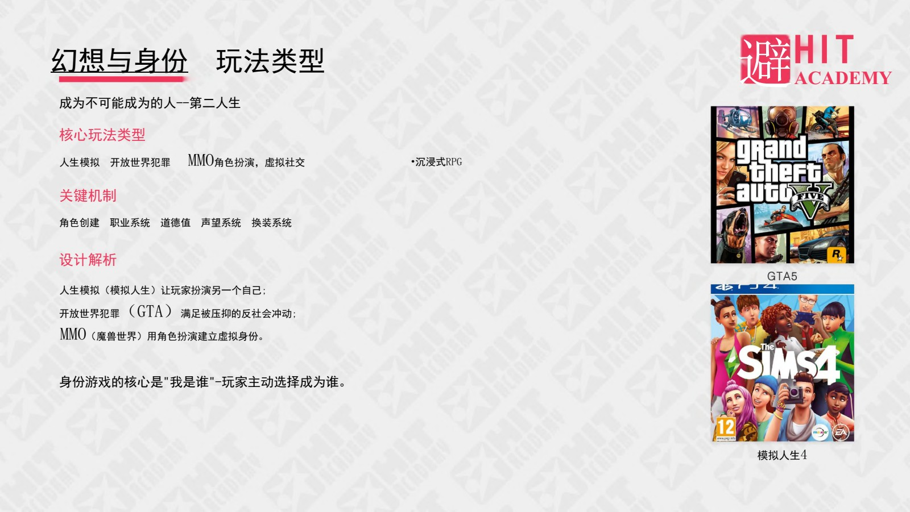

## 第 086 页 · 幻想与身份 · 主题

幻想与身份，主题  
成为不可能成为的人--第二人生  
常见题材  
现代都市 ・ 中世纪奇幻，赛博朋克 ・ 西部荒野,虚拟空间  
氛围关键词  
解放的，沉浸的，越界的，幻想的  
主题解析  
剑与魔法（博德之门 3） 让玩家书写自己的传奇；  
古希腊史诗（刺客信条:奥德赛）让游客成为传奇佣兵；  
赛博朋克 （2077） 探讨身份与肉体。主题是"不可能"。  
现实中你不可能抢银行、不可能施魔法、不可能有多个生命一游戏中可以。  
避 HIT  
博德之门 3  
刺客信条：奥德赛

[本页原始文字层](core-experience-design-source.md#page-086)

## 第 087 页 · 幻想与身份 · 考验能力

幻想与身份考验能力  
成为不可能成为的人--第二人生  
核心能力  
角色扮演选择 ・ 身份维持，道德演绎 ・ 创意表达  
认知要求  
构建角色背景故事 ・ 维持角色一致性 ・ 理解虚拟社会规则  
能力解析  
RP (Role Play) 玩家会为角色写背景故事，做符合角色性格的选择。  
这种 "method acting" 能力让虚拟身份有了重量。  
身份游戏的考验是"你能在多大程度上成为另一个人?"  
天国：拯救

[本页勘误／补录](core-experience-design-errata.md#page-087)。

[本页原始文字层](core-experience-design-source.md#page-087)

## 第 088 页 · 幻想与身份 · 体验循环

幻想与身份・ 体验循环  
成为不可能成为的人--第二人生  
十活玉 设定人生目标一 扮演行动一承担后果 身份逐渐成形  
小时级 以"一段人生章节"为单位,玩家亲手雕刻"我是谁"  
中循环 接一个任务7赚钱/社交/布置 一推动生活前进  
分钟级 每个任务都是第二人生的一天缩影  
小循环 驾驶一,对话一互动一即兴发挥  
秒级 秒级操作即"扮演"本身--每个动作都在宣告"这是我"

### 图示顺序转写

- 大循环：设定人生目标 → 扮演行动 → 承担后果 → 身份逐渐成形
- 中循环：接一个任务 → 赚钱/社交/布置 → 推动生活前进
- 小循环：驾驶 → 对话 → 互动 → 即兴发挥

[本页原始文字层](core-experience-design-source.md#page-088)

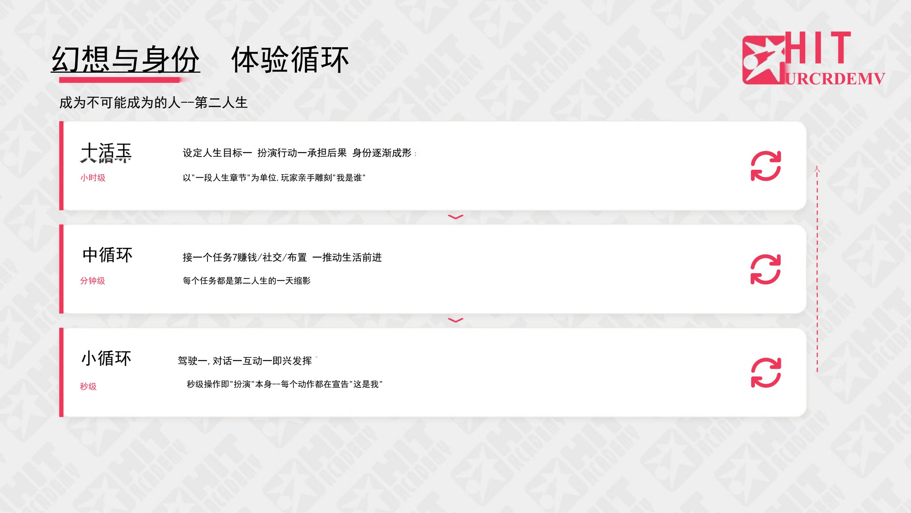

## 第 089 页 · 幻想与身份 · 对比原理

幻想与身份 ・ 对比原理  
成为不可能成为的人--第二人生  
核心原理  
身份落差=幻想强度  
公式类型  
剥夺-给予型：现实自我（基线）一虚拟身份（对比）一幻想满足  
深度解析  
身份体验的价值来自"现实自我"与"虚拟自我"的落差。  
现实中是上班族，游戏中是超级英雄--落差越大,代入感越强。  
对比公式：幻想强度=虚拟能力/现实能力。  
但过度落差会导致代入困难（难以共情超人）,好的设计让玩家觉得"这像是我会做的事"。  
骑马与砍杀 2

[本页原始文字层](core-experience-design-source.md#page-089)

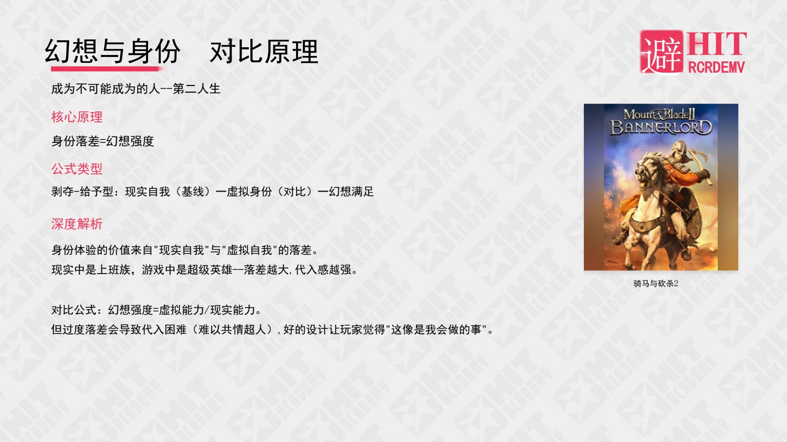

## 第 090 页 · 幻想与身份 · 纵向体验层次

【按原图四层对应关系重排；损坏层名不猜补】

| 层级 | 时间与阶段 | 原文说明 | 原文案例 |
|---|---|---|---|
| L1【层名缺损】 | 即时吸引：0–30 秒 | 精美的世界与自由的活法,”成为另一个人"的诱惑 | GTA5、刺客信条:奥德赛 |
| L2 行为层 | 上手投入：单次会话 | 角色扮演中的每个选择,塑造独一无二的人生轨迹 | 模拟人生4、博德之门3 |
| L3 情感层 | 持续沉浸：数日至数周 | 第二人生的持续经营,虚拟身份逐渐丰满立体 | 质量效应：传奇版、天国：拯救 |
| L4【层名缺损】 | 长期认同：数月以上 | "另一个我"成为自我探索的出口与投射 | 骑马与砍杀2 |

[本页原始文字层](core-experience-design-source.md#page-090)

## 第 091 页 · 博弈与心理 · 章节页

・ 季F A  
博弈体验

[本页原始文字层](core-experience-design-source.md#page-091)

## 第 092 页 · 博弈与心理 · 玩法类型

博弈与心理 ・ 玩法类型  
与人斗--读懂与误导的心跳  
核心玩法类型  
社交推理，卡牌对战，竞技心理战 ・ 谈判交易 Bluffing  
关键机制  
隐藏身份，手牌管理 •心理博弈 ・ 信息隐藏 •虚张声势  
设计解析  
社交推理（鹅鸭杀）用语言和行为传递真假信息；  
卡牌对战（炉石）用隐藏手牌制造不确定性；  
竞技（第五人格）用走位误导对手。  
• • • •  
炉石传说  
博弈游戏的核心是"信息不对等-我知道一些你不知道的事。  
万智牌：竞技场

[本页原始文字层](core-experience-design-source.md#page-092)

## 第 093 页 · 博弈与心理 · 主题

博【疑字／缺字：原 OCR 为 ^】与心理・ 主题 MIT  
与人斗--读懂与误导的心跳  
常见题材  
狼人村庄，魔法对决・ 法庭辩论，地下赌局 恐怖追猎  
氛围关键词  
悬念重重的，紧绷的，谋略的，智力胜利的  
主题解析  
狼人村庄（鹅鸭杀）将社交关系变成战场；  
魔法对决（游戏王）用卡牌规则模拟智谋交锋；  
恐怖追猎（黎明杀机）用信息不对称制造猫鼠游戏。  
游戏王：大师决斗  
主题是"人心"--比AI更难预测的是真人。  
小丑牌

[本页原始文字层](core-experience-design-source.md#page-093)

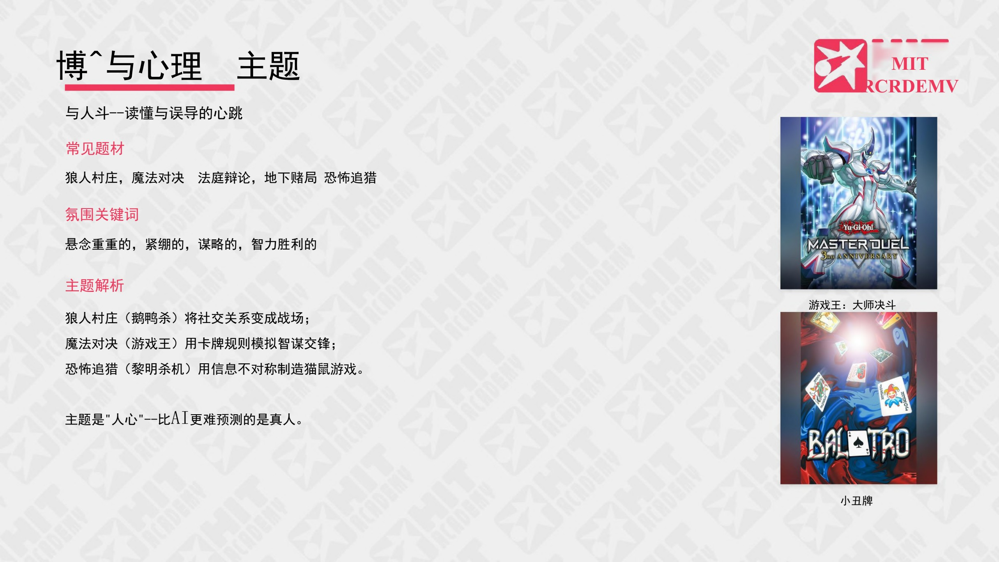

## 第 094 页 · 博弈与心理 · 考验能力

博【疑字／缺字：原 OCR 为 ^】与心理考验能力  
与人斗--读懂与误导的心跳  
核心能力  
读人，表演，概率计算，逻辑推理 ・ 情绪控制  
认知要求  
构建对手模型 ・ 计算最优策略 ・ 识别 Bluff （虚张声势）  
能力解析  
博弈游戏考验的是"心智理论"--你能否站在对手的角度思考？  
高手不仅计算概率，还计算"对手认为我会怎么做"。  
表演能力也同样重要一在鹅鸭杀中，一个镇定的谎言比逻辑更致命。  
INSCRYPTION  
邪恶冥刻  
骰子地下城

[本页原始文字层](core-experience-design-source.md#page-094)

## 第 095 页 · 博弈与心理 · 体验循环

博【疑字／缺字：原 OCR 为 ^】与心理・ 体验循环 HIT  
与人斗--读懂与误导的心跳  
大循环  
小时级  
入局 一收集信息建立判断一 摊牌对决一 复盘人心  
以"一局"为单位--胜负之外,还有"谁骗了谁"的故事 $  
中循环  
分钟级  
观察发言分推理演算一下注/投票一验证猜测  
每个回合都是一次"读人"的小考  
小循环 控制表情 一 快速回应 一出牌/反问  
秒级 秒级的镇定与破绽，决定了别人如何读你

### 图示顺序转写

- 大循环：入局 → 收集信息建立判断 → 摊牌对决 → 复盘人心
- 中循环：观察发言 → 推理演算 → 下注/投票 → 验证猜测
- 小循环：控制表情 → 快速回应 → 出牌/反问

[本页原始文字层](core-experience-design-source.md#page-095)

## 第 096 页 · 博弈与心理 · 对比原理

博弈与心理 ・ 对比原理  
与人斗--读懂与误导的心跳  
核心原理  
"我知道你不知道的"信息差快感  
公式类型  
蓄-放型:信息积累（试探）一摊牌（释放）一胜负  
深度解析  
博弈的快感来自信息优势的建立。从一无所知（开局）到逐步收集信息（试探），再到确认优势（摊牌）,  
最后是胜负释放。对比公式：博弈快感=信息差 X赌注大小。关键设计：必须让玩家有"我几乎要赢了'的  
错觉--这是诱使对手跟注/深入的最佳 bal  
怪物火车

[本页勘误／补录](core-experience-design-errata.md#page-096)。

[本页原始文字层](core-experience-design-source.md#page-096)

## 第 097 页 · 博弈与心理 · 纵向体验层次

【按原图四层对应关系重排；损坏层名不猜补】

| 层级 | 时间与阶段 | 原文说明 | 原文案例 |
|---|---|---|---|
| L1【层名缺损】 | 即时吸引：0–30 秒 | 抽牌的期待与反转,一回合一次心跳 | 炉石传说、小丑牌 |
| L2 行为层 | 上手投入：单次会话 | 读牌读人,计算概率与风险的决策快感 | 万智牌:竞技场、骰子地下城 |
| L3 情感层 | 持续沉浸：数日至数周 | 构筑与对局理解加深,享受"算无遗策"的智力优越感 | 游戏王：大师决斗、怪物火车 |
| L4【层名缺损】 | 长期认同：数月以上 | 博弈思维内化为思考方式，牌桌如人生 | 邪恶冥刻 |

[本页原始文字层](core-experience-design-source.md#page-097)

## 第 098 页 · 认知好奇心 · 章节页

认知体验

[本页原始文字层](core-experience-design-source.md#page-098)

## 第 099 页 · 认知好奇心 · 玩法类型

认知好奇心 ・ 玩法类型  
知识拼图--"原来如此!"  
核心玩法类型  
知识解谜 •考古探索 ・ 信息拼图 ・ 硬科幻推理 ・ 非线性叙事  
关键机制  
日志系统 ・ 线索关联 ・ 多源验证 •知识锁（不懂过不去） ・ 顿悟触发  
设计解析  
Outer Wilds 式的知识驱动:知识即进度。  
玩家不是在收集钥匙开地图，而是在收集"理解"开宇宙。  
每一个新发现都重构过去所有信息的含义,直到最终顿悟一原来一切都是相连的。  
Outer Wilds  
见证者

[本页原始文字层](core-experience-design-source.md#page-099)

## 第 100 页 · 认知好奇心 · 主题

认知好奇心」・ 主题  
知识拼图--"原来如此!"  
常见题材  
宇宙考古•失落文明・ 深空异常・ 时间循环・ 硬科幻  
氛围关键词  
惊奇•谜团·敬畏•惆怅  
主题解析  
实验室逃脱（传送门2）用传送门重构空间直觉；  
机械伊甸（塔罗斯的法则）用谜题追问意识与自由。  
传送门2  
主题是"真相的层次"-表面是探索,深层是理解,最深层是接受。  
塔罗斯的法则

[本页原始文字层](core-experience-design-source.md#page-100)

## 第 101 页 · 认知好奇心 · 考验能力

认知好奇心 ・ 考验能力  
知识拼图--"原来如此!"  
核心能力  
信息整合 ・ 联想能力，耐心，笔记习惯 ・ 模式识别  
认知要求  
跨线索关联，假设-验证循环,心智模型构建  
能力解析  
认知好奇型玩家像侦探--,他们会做笔记、画关联图、反复验证假设。  
他们不追求"打过去",而追求"想明白"。  
这种体验的门槛很高，但顿悟的回报也是所有体验中最强烈的。  
巴巴是你  
FEZ

[本页原始文字层](core-experience-design-source.md#page-101)

## 第 102 页 · 认知好奇心 · 体验循环

认知好奇心・ 体验循环  
知识拼图-- "原来如此!"  
大循环  
小时级  
提出假设 一跨越星球验证 一推翻/确认 一重构认知地图  
以”一个谜题"为单位--进度=理解,而非收集  
中循环  
分钟级  
深入遗迹 一阅读线索一联想拼接 一顿悟"原来如此!"  
每一次顿悟,都是中循环的奖赏 0  
小循环 移动视角一操作仪器一观察现象一记录发现  
秒级 秒级操作很轻--因为重量全在"想"上 J

### 图示顺序转写

- 大循环：提出假设 → 跨越星球验证 → 推翻/确认 → 重构认知地图
- 中循环：深入遗迹 → 阅读线索 → 联想拼接 → 顿悟“原来如此！”
- 小循环：移动视角 → 操作仪器 → 观察现象 → 记录发现

[本页原始文字层](core-experience-design-source.md#page-102)

## 第 103 页 · 认知好奇心 · 对比原理

认知好奇心 ・ 对比原理  
知识拼图--"原来如此!"  
核心原理  
顿悟必须由玩家自己的拼图完成  
公式类型  
蓄一放型：碎片积累（蓄压）一终极顿悟（释放）一怅然若失  
深度解析  
设计禁忌：不能直接告诉玩家答案--小循环给碎片,大循环才给颤抖。  
顿悟的爽感与玩家的"自主拼图程度"成正比。  
对比公式：顿悟震撼=拼图自主度X真相深度。  
被剧透的奥伯拉丁的回归等于被毁掉的奥伯拉丁的回归。  
奥伯拉丁的回归

[本页原始文字层](core-experience-design-source.md#page-103)

## 第 104 页 · 认知好奇心 · 纵向体验层次

【按原图四层对应关系重排；损坏层名不猜补】

| 层级 | 时间与阶段 | 原文说明 | 原文案例 |
|---|---|---|---|
| L1 感官层 | 即时吸引：0–30 秒 | 神秘的谜面与反常的现象,勾住"为什么"的直觉 | 见证者、传送门2 |
| L2 行为层 | 上手投入：单次会话 | 观察一假设一验证的推理循环,每个谜题都有顿悟时刻 | 巴巴是你、FEZ |
| L3 情感层 | 持续沉浸：数日至数周 | 知识本身即钥匙：理解规则后,世界豁然开朗 | Outer Wilds 、奥伯拉丁的回归 |
| L4【层名缺损】 | 长期认同：数月以上 | 顿悟的快感滋养求知欲,改变看待世界的方式 | 塔罗斯的法则 |

[本页原始文字层](core-experience-design-source.md#page-104)

## 第 105 页 · 悬念·抽卡 · 章节页

公 文 0 当 心/Ha2

[本页原始文字层](core-experience-design-source.md#page-105)

## 第 106 页 · 悬念·抽卡 · 玩法类型

悬念 ・ 抽卡.玩法类型 HIT  ND RCRDEMV  
情绪体验组 ・ 期待感主导  
核心玩法类型  
Gacha 抽卡 ・ 卡池轮换，保底机制，碎片合成，开箱系统  
关键机制  
概率公示 •保底计数 ・ 动画悬念 ・ 图鉴展示 •限时卡池  
设计解析  
抽卡的核心设计是"动画渐强"--按下按钮到揭晓的那 5 秒，多巴胺分泌最强烈。  
保底机制提供确定性兜底，概率公示维持信任，限时卡池制造稀缺。  
原神  
它是行为心理学在游戏中最极致的应用。  
崩坏 3

[本页原始文字层](core-experience-design-source.md#page-106)

## 第 107 页 · 悬念·抽卡 · 主题

悬念 ・ 抽卡.主题  
情绪体验组的期待感主导  
常见题材  
二次元角色 ・ 武器池 ・ 皮肤/外观限定联动，收藏图鉴  
氛围关键词  
满怀期待的 •兴奋的 •失望的 •狂喜的  
主题解析  
抽卡游戏的主题往往是"拥有"--拥有角色、拥有皮肤、拥有稀有度。  
角色设计不只是美术,更是"欲望的对象":人设、配音、强度、稀有度共同构成玩家"想要"的理由。  
影之诗  
Apex 英雄

[本页原始文字层](core-experience-design-source.md#page-107)

## 第 108 页 · 悬念·抽卡 · 考验能力

US HF ・ 考验能力  
情绪体验组，期待感主导  
核心能力  
资源规划 ・ 概率计算，自制力，期望管理 ・ 沉没成本控制  
认知要求  
期望值计算 •保底策略 •抽/攒决策  
能力解析  
抽卡玩家需要对抗的不是游戏，而是自己的冲动。  
高手玩家精算概率、规划资源、只在最优时机出手；  
普通玩家被"就差一个吗区动，陷入沉没成本陷阱。  
军团要塞 2  
抽卡体验的隐藏考验是:你能否在多巴胺面前保持理性?  
WARFRAME  
1999  
星际战甲

[本页勘误／补录](core-experience-design-errata.md#page-108)。

[本页原始文字层](core-experience-design-source.md#page-108)

## 第 109 页 · 悬念·抽卡 · 体验循环

悬念.  
情绪体验组  
大循环  
抽卡 ，体验循环  
・  期待感主导  
日常攒资源一等待卡池一集中抽取一养成分配  
以"一个卡池周期"为单位--期待感随时间发酵  
再攒  
中循环  
分钟级  
十连点击一 动画悬念 一逐张揭晓 一 狂喜/失落  
一次十连,就是一部微缩悬疑片  
再来一发?  
小循环 按下按钮 一屏息一金光闪现一心跳定格  
秒级 那3秒动画,是全年最浓缩的情绪体验

### 图示顺序转写

- 大循环：日常攒资源 → 等待卡池 → 集中抽取 → 养成分配 → 再攒
- 中循环：十连点击 → 动画悬念 → 逐张揭晓 → 狂喜/失落 → 再来一发？
- 小循环：按下按钮 → 屏息 → 金光闪现 → 心跳定格

[本页原始文字层](core-experience-design-source.md#page-109)

## 第 110 页 · 悬念·抽卡 · 对比原理

悬念・ 抽卡 ・ 对比原理  
情绪体验组，期待感主导  
核心原理  
99% 一 100% 的心理落差（蔡格尼克效应）  
公式类型  
蓄一放型：期待发酵（预告一开池）一单抽揭晓（秒级多巴胺）一得到或"差一点"  
深度解析  
人对未完成的任务记忆更深刻-- 99% 的图鉴比 50% 更令人焦虑。  
抽卡正是利用这种"缺口焦虑"。  
对比公式：抽卡驱动力=完成度 x（100%- 完成度）。  
当完成度接近 100% 时,驱动力达到最大。设计师的悖论：让玩家永远"差一个"。  
失落的方舟

[本页勘误／补录](core-experience-design-errata.md#page-110)。

[本页原始文字层](core-experience-design-source.md#page-110)

## 第 111 页 · 悬念·抽卡 · 纵向体验层次

【按原图四层对应关系重排；损坏层名不猜补】

| 层级 | 时间与阶段 | 原文说明 | 原文案例 |
|---|---|---|---|
| L1【层名缺损】 | 即时吸引：0–30 秒 | 华丽的抽卡演出,金光一闪的多巴胺冲击 | 原神、崩坏3 |
| L2 行为层 | 上手投入：单次会话 | 攒资源、等卡池，期待管理让每次抽取仪式感拉满 | 影之诗、Apex英雄 |
| L3 情感层 | 持续沉浸：数日至数周 | 收集与养成的长期目标,沉没成本转化为牵挂 | 失落的方舟、星际战甲 |
| L4【层名缺损】 | 长期认同：数月以上 | 角色厨力与身份标签,成为社群中的自我表达 | 军团要塞2 |

[本页原始文字层](core-experience-design-source.md#page-111)

## 第 112 页 · 敬畏体验 · 章节页

敬畏体验

[本页原始文字层](core-experience-design-source.md#page-112)

## 第 113 页 · 敬畏体验 · 玩法类型

敬【疑字／缺字：原 OCR 为 ^】体验 ・ 玩法类型  
巨物与星空——"渺小而颤栗"  
核心玩法类型  
巨物遭遇 ・ 史诗尺度，宇宙漫游自然奇观 ・ 文明遗迹  
关键机制  
尺度对比 ・ 远景揭示,不可交互，环境叙事，音乐铺垫  
设计解析  
敬畏体验的核心是"尺度"--当玩家角色站在数百米高的巨像脚下,或从太空俯瞰整颗星球时，自我被缩小  
到尘埃。  
设计上故意弱化交互：你只能看、只能感受,神圣感恰恰来自"无法触碰"。  
风之旅人

[本页勘误／补录](core-experience-design-errata.md#page-113)。

[本页原始文字层](core-experience-design-source.md#page-113)

## 第 114 页 · 敬畏体验 · 主题

敬畏体验，主题 HIT  
巨物与星空——"渺小而颤栗"  
常见题材  
巨像荒原，深空•失落文明・ 自然伟力，宇宙尺度  
氛围关键词  
敬畏•崇高的•惆怅，使人谦卑的  
主题解析  
ABZU  
地平线中的机械巨兽既是猎物也是神迹;  
ABZU的深海是朝圣而不是关卡。  
敬畏主题的底色是"人在宇宙中的位置,一不是征服,而是谦卑。这类体验最接近康德所说的"崇高"。  
地平线：零之曙光

[本页原始文字层](core-experience-design-source.md#page-114)

## 第 115 页 · 敬畏体验 · 考验能力

敬畏体验，考验能力  
巨物与星空——"渺小而颤栗"  
核心能力  
情绪感受力，沉浸能力、审美理解  
认知要求  
解读环境叙事 ・ 理解尺度对比自我定位  
能力解析  
敬畏体验几乎不考验"操作，它考验的是"感受"。  
能否在巨物面前停下脚步、抬头、沉默--这种能力不是游戏技巧,而是审美心态。  
它筛选的不是玩家，而是"愿意被打动的人"。  
RiME  
星空

[本页原始文字层](core-experience-design-source.md#page-115)

## 第 116 页 · 敬畏体验 · 体验循环

敬畏体验，体验循环  
巨物与星空——”渺小而颤栗"  
十活玉 漫长跋涉 一远远望见巨物 T怀着敬畏接近一 沉默离开  
小时级 以"一次朝圣"为单位--仪式感来自漫长的铺垫  
中循环  
分钟级  
驻足仰望一绕行观察一逐渐看清全貌一被尺度击中  
"看" 本身就是玩法--凝望即交互  
小循环  
秒级  
该体验刻意不做小循环------ 不可交互、不可拆解  
神圣感恰恰来自"你只能看"--凝望本身就是全部交互

### 图示顺序转写

- 大循环：漫长跋涉 → 远远望见巨物 → 怀着敬畏接近 → 沉默离开
- 中循环：驻足仰望 → 绕行观察 → 逐渐看清全貌 → 被尺度击中
- 小循环：原文：该体验刻意不做小循环——不可交互、不可拆解。神圣感恰恰来自“你只能看”——凝望本身就是全部交互。

[本页原始文字层](core-experience-design-source.md#page-116)

## 第 117 页 · 敬畏体验 · 对比原理

敬畏体验，对比原理  
巨物与星空——"渺小而颤栗"  
核心原理  
尺度对比--大与小的极致落差  
公式类型  
蓄-放型：日常尺度（蓄）一宏大遭遇（放）一渺小化战栗-平复-更大的宏大  
深度解析  
敬畏体验的设计核心是"对比"。  
如果整个世界都是巨物,就没有敬畏--正因为 99% 的时间是"人的尺度",那 1% 的宏大才震撼。  
对比公式：敬畏感=尺度落差 x 遭遇突然性。  
INSIDE 的巨物总在远处先露出轮廓，就是这种蓄压。  
INSIDE

[本页原始文字层](core-experience-design-source.md#page-117)

## 第 118 页 · 敬畏体验 · 纵向体验层次

【按原图四层对应关系重排；损坏层名不猜补】

| 层级 | 时间与阶段 | 原文说明 | 原文案例 |
|---|---|---|---|
| L1【层名缺损】 | 即时吸引：0–30 秒 | 宏大的场景与渺小的自己，瞬间的震撼与失语 | 旺达与巨像、ABZU |
| L2 行为层 | 上手投入：单次会话 | 在壮丽中前行,环境叙事取代对白传递情绪 | 风之旅人、RiME |
| L3 情感层 | 持续沉浸：数日至数周 | 旅途的孤独与崇高感交织,产生超越日常的体验 | 地平线：零之曙光、星空 |
| L4【层名缺损】 | 长期认同：数月以上 | 敬畏改变玩家的尺度感，成为难忘的"精神地标" | INSIDE |

[本页原始文字层](core-experience-design-source.md#page-118)

## 第 119 页 · 怀旧体验 · 章节页

怀旧体验

[本页原始文字层](core-experience-design-source.md#page-119)

## 第 120 页 · 怀旧体验 · 玩法类型

怀旧体验玩法类型  
回到过去-"这是我的童年"  
核心玩法类型  
复古游戏 ・ 重制版 ・ 经典 IP 续作，像素风，复古玩法  
关键机制  
像素画面 ・ 8-bit 音乐 ・ 经典玩法复刻 ・ 彩蛋致敬老角色回归  
设计解析  
重制版 （FF7 重制）用现代技术重现经典;  
复古游戏（马力欧奥德赛）继承玩法精髓；  
像素风（铲子骑士）致敬黄金时代。  
怀旧游戏的核心是"熟悉的安心感"-你知道你会喜欢它,因为它让你想起喜欢的过去。  
避 HIT  
超级马力欧奥德赛  
FF7 重制版

[本页原始文字层](core-experience-design-source.md#page-120)

## 第 121 页 · 怀旧体验 · 主题

怀旧体验.主题  
回到过去-"这是我的童年"  
常见题材  
8-bit 世界 ・ 经典重现，童年记忆，黄金年代，复古未来  
氛围关键词  
怀旧的,温暖的,熟悉的,安慰性的  
主题解析  
怀旧与情怀的主题是"回忆"。  
索尼克的冲刺音效、【疑字／缺字：原 OCR 为 ^】子骑士的 8-bit 配乐、暗黑 2 的装备掉落--这些声音和画面直接连接玩家的童年。  
怀旧游戏不需要创新,它需要的是"对"。  
避 HIT  
铲子骑士

[本页勘误／补录](core-experience-design-errata.md#page-121)。

[本页原始文字层](core-experience-design-source.md#page-121)

## 第 122 页 · 怀旧体验 · 考验能力

怀旧体验 ・ 考验能力  
回到过去-"这是我的童年"  
核心能力  
情感记忆，文化共鸣 ・ 耐心适应，发现彩蛋，分享交流  
认知要求  
识别致敬元素 ・ 理解时代背景 ・ 连接个人经历  
能力解析  
怀旧型玩家的核心能力是"连接"--将游戏中的元素与 personal memory 连接。  
他们能说出"这个 Boss 是致敬《魂斗罗》第三关",能在怒之铁拳 4 的街机配乐中热泪盈眶。  
这种能力让游戏超越娱乐，成为情感的载体。  
怒之铁拳 4

[本页勘误／补录](core-experience-design-errata.md#page-122)。

[本页原始文字层](core-experience-design-source.md#page-122)

## 第 123 页 · 怀旧体验 · 体验循环

怀旧体验  
体验循环 HIT  
回到过去-"这是我的童年"  
大循环 重访旧场景 一认出熟悉元素 一情感共【疑字／缺字：原 OCR 为 ^】 一分享/截图  
小时级 以"一段重游"为单位--记忆不断被点亮  
中循环 发现彩蛋 一"这里我记得!" 一驻足回味一拍照留念  
分钟级 每个复刻细节，都是一次久别重逢 0  
小循环  
秒级  
跳跃一 顶砖块 一 吃金币一8-bit音效  
秒级手感本身就在复刻童年--肌肉记忆比大脑先到家

### 图示顺序转写

- 大循环：重访旧场景 → 认出熟悉元素 → 情感共[原页缺字] → 分享/截图
- 中循环：发现彩蛋 → “这里我记得！” → 驻足回味 → 拍照留念
- 小循环：跳跃 → 顶砖块 → 吃金币 → 8-bit 音效

[本页原始文字层](core-experience-design-source.md#page-123)

## 第 124 页 · 怀旧体验 · 对比原理

怀旧体验.对比原理  
回到过去-"这是我的童年"  
核心原理  
时间对比--"过去的美好" vs" 现在的复杂"  
公式类型  
蓄-放型：记忆积累（蓄压）一 触发点（释放）一 情感涌动  
深度解析  
怀旧体验的核心是"时间差"。  
童年的简单快乐与成年后的复杂压力形成对比，而怀旧游戏成为通往过去的时光机。  
对比公式：怀旧感=记忆强度 x 时间距离。  
20 年前的游戏比 2 年前的游戏更令人怀旧,因为时间已经将它美化。  
八方旅人

[本页原始文字层](core-experience-design-source.md#page-124)

## 第 125 页 · 怀旧体验 · 纵向体验层次

【按原图四层对应关系重排；损坏层名不猜补】

| 层级 | 时间与阶段 | 原文说明 | 原文案例 |
|---|---|---|---|
| L1 感官层 | 即时吸引：0–30 秒 | . 熟悉的旋律与像素风,瞬间唤醒童年记忆 | 索尼克:狂欢、铲子骑士 |
| L2 行为层 | 上手投入：单次会话 | 经典玩法的全新演绎，既熟悉又新鲜 | 超级马力欧奥德赛、怒之铁拳 4 |
| L3 情感层 | 持续沉浸：数日至数周 | 彩蛋与致敬层层挖掘,与过去的自己重逢 |  FF7 重制版、八方旅人 |
| L4【层名缺损】 | 长期认同：数月以上 | 怀旧成为情感锚点，连接两代人的共同语言 | 忍者神龟：施莱德的复仇 |

[本页原始文字层](core-experience-design-source.md#page-125)

## 第 126 页 · 道德负罪 · 章节页

坦143

[本页原始文字层](core-experience-design-source.md#page-126)

## 第 127 页 · 道德负罪 · 玩法类型

道德负罪 .玩法类型  
无法清白的历史--"这一切值得吗"  
核心玩法类型  
道德抉择 ・ 生存困境，战争平民 ・ 电车难题，社会拷问  
关键机制  
两难选项 •后果呈现 ・ 沉默镜头 ・ 道德记账,终局审判  
设计解析  
冰汽时代的"这一切值得吗"、这是我的战争里偷平民物资的负罪-  
游戏不给你"做好人"的选项,只有"选哪个更不疼"。  
-道德负罪体验的核心是"没有正确答案"。  
避 RCRDEMV  
这是我的战争

[本页勘误／补录](core-experience-design-errata.md#page-127)。

[本页原始文字层](core-experience-design-source.md#page-127)

## 第 128 页 · 道德负罪 · 主题

道德负罪为主题  
无法清白的历史--"这一切值得吗"  
常见题材  
末日极寒:战争废墟 ・ 极权社会:瘟疫孤岛 dystopia  
氛围关键词  
残酷的负罪的，沉重的开发人深省的  
主题解析  
道德负罪的主题是"代价"。  
你签发的每一道法令、偷走的每一份物资、放弃的每一个幸存者,都有名字、有脸、有遗言。  
这类游戏拒绝英雄叙事一你不是救世主,只是一个在烂选择里做选择的普通人。  
请出示证件  
Beholder  
旁观者

[本页原始文字层](core-experience-design-source.md#page-128)

## 第 129 页 · 道德负罪 · 考验能力

道德负罪 .考验能力  
无法清白的历史--"这一切值得吗"  
核心能力  
道德判断，后果预判，情绪承受自我反思 ・ 价值排序  
认知要求  
多目标权衡 ・ 后果链推演，价值不值"的内心秤  
能力解析  
道德负罪体验考验的是"你能承受多少"。  
它不要求技巧,要求的是面对后果不逃避、不用锅。  
玩家在游戏里做的每个选择,都是一次价值观的显影一游戏结束,审判的是自己。  
传说之下

[本页勘误／补录](core-experience-design-errata.md#page-129)。

[本页原始文字层](core-experience-design-source.md#page-129)

## 第 130 页 · 道德负罪 · 体验循环

道德负罪・ 体验循环 HIT  
无法清白的历史  
大循环  
中循环  
小循环  
"这一切值得吗"  
资源告急 T 被迫抉择 一承担后果一 目【疑字／缺字：原 OCR 为 ^】代价一 继续【疑字／缺字：原 OCR 为 ^】活  
以"一个生存周期"为单位--每次抉择都在消耗"无辜" 个  
面对两难 一 艰难决定一立即看到结果 一良心结算  
没有正确答案--只有"选哪个更不坏"  
光标悬停7犹豫7按下确认一不敢看屏幕  
秒级 秒级的迟疑本身就是体验--设计师要的就是你手抖

### 图示顺序转写

- 大循环：资源告急 → 被迫抉择 → 承担后果 → 目[原页缺字]代价 → 继续[原页缺字]活
- 中循环：面对两难 → 艰难决定 → 立即看到结果 → 良心结算
- 小循环：光标悬停 → 犹豫 → 按下确认 → 不敢看屏幕

[本页原始文字层](core-experience-design-source.md#page-130)

## 第 131 页 · 道德负罪 · 对比原理

道德负罪 .对比原理  
无法清白的历史--"这一切值得吗"  
核心原理  
沉默呈现后果,不给开脱台词  
公式类型  
剥夺-给予型：被迫抉择（剥夺清白）一后果显现（给予重量）一愧疚沉淀  
深度解析  
设计关键：小小循环里"不给解释"最重要-设计师一旦替你开脱，拷问就失效了。  
«行尸走肉》结局那句"照顾好她"之所以刺痛,是因为游戏全程没有替玩家辩护。  
对比公式：负罪深度= 抉择自主性 X 后果呈现的沉默度。  
避 HIT  
行尸走肉

[本页原始文字层](core-experience-design-source.md#page-131)

## 第 132 页 · 道德负罪 · 纵向体验层次

【按原图四层对应关系重排；损坏层名不猜补】

| 层级 | 时间与阶段 | 原文说明 | 原文案例 |
|---|---|---|---|
| L1 感官层 | 即时吸引：0–30 秒 | 两难的抉择摆在面前，没有完美答案 | 代表案例:请出示证件、旁观者 |
| L2 行为层 | 上手投入：单次会话 | 每个决定都有代价,系统让玩家"不得不作恶" | 冰汽时代、这是我的战争 |
| L3 情感层 | 持续沉浸：数日至数周 | 负罪感与自我辩护的拉扯，被迫审视自己的价值观 | 行尸走肉、传说之下 |
| L4【层名缺损】 | 长期认同：数月以上 | 道德反思延伸到现实,游戏成为人性的镜子 | 特殊行动：一线生机 |

[本页原始文字层](core-experience-design-source.md#page-132)

## 第 133 页 · 权力体验 · 章节页

权力体验

[本页原始文字层](core-experience-design-source.md#page-133)

## 第 134 页 · 权力体验 · 玩法类型

权力体验.玩法类型  
从棋子到棋手一"我说了算"  
核心玩法类型  
策略统治 ・ 城市建设， 4X 游戏，大战略，经营帝国  
AHIT  ACADEMY  
关键机制  
法令系统 ・ 税收调配 ・ 军队指挥，外交博弈 •政策树  
设计解析  
权力体验的核心是"意志的落地"--你的每个决定影响数百万虚拟人口的命运。  
文明 6的"再来一回合"、钢铁雄心的全局调度、十字军之王 3的家族权谋：权力游戏让人体验"站在棋盘之上"  
的视角。  
文明 6  
钢铁雄心 4

[本页原始文字层](core-experience-design-source.md#page-134)

## 第 135 页 · 权力体验 · 主题

权力体验.主题  
从棋子到棋手 一"我说了算"  
常见题材  
帝国崛起，文明演进，宫廷权谋，战争统帅，乌托邦/反乌托邦  
氛围关键词  
强大的,雄心勃勃的,厚重的，如神的  
主题解析  
权力主题的核心是"掌控感"。  
从开局的一城一池到后期的世界霸权，玩家书写的不仅是胜利,是一部崛起史诗。  
十字军之王 3  
但好的权力游戏也会展示权力的代价一 m每一个"我说了算"的背后,是无数 NPC 的人生。  
欧陆风云 4

[本页原始文字层](core-experience-design-source.md#page-135)

## 第 136 页 · 权力体验 · 考验能力

权力体验.考验能力  
从棋子到棋手一"我说了算"  
核心能力  
长期规划,资源调度・ 权衡取舍，多线思维 冷酷决策  
认知要求  
全局观・ 连锁反应预判・  机会成本计算  
能力解析  
权力玩家像棋手--看十步而非一步。  
他们知道今天的忍让是明天的反击，现在的投入是30回合后的爆发。  
这种"战略耐心"是权力体验的核心能力,也是最难习得的游戏技巧。  
全面战争:三国

[本页勘误／补录](core-experience-design-errata.md#page-136)。

[本页原始文字层](core-experience-design-source.md#page-136)

## 第 137 页 · 权力体验 · 体验循环

权力体验,体验循环  
从棋子到棋手一"我说了算"  
大循环 经营内政一扩张势力一发动战争一加冕霸权  
小时级 以"一个时代"为单位--权力版图不断重画  
中循环 评估全局一下达指令一结算回合一修正战略  
分钟级 "再来一回合"--每个回合都是一次微型统治  
小循环 移动单位一点选科技一签署法令一查看报表  
新的挑战  
秒级 秒级操作很琐碎--但每一次点击都是"我说了算"

### 图示顺序转写

- 大循环：经营内政 → 扩张势力 → 发动战争 → 加冕霸权 → 新的挑战
- 中循环：评估全局 → 下达指令 → 结算回合 → 修正战略
- 小循环：移动单位 → 点选科技 → 签署法令 → 查看报表

[本页原始文字层](core-experience-design-source.md#page-137)

## 第 138 页 · 权力体验 · 对比原理

权力体验.对比原理  
从棋子到棋手一"我说了算"  
核心原理  
起点必须是无力感--没有剥夺，给予就没有重量  
公式类型  
剥夺-给予型：无力（剥夺）7获得力量（给予）-验证-掌控  
深度解析  
权力体验的设计公式与成长体验相通,但更强调"决策的重量"。  
对比公式：权力快感=控制的范围 x决策的重量。  
能决定千万人命运的权力，才是真正的权力。开局弱小不是缺陷,是让后期强大有意义的必需品。  
XCOM 2

[本页原始文字层](core-experience-design-source.md#page-138)

## 第 139 页 · 权力体验 · 纵向体验层次

【按原图四层对应关系重排；损坏层名不猜补】

| 层级 | 时间与阶段 | 原文说明 | 原文案例 |
|---|---|---|---|
| L1【层名缺损】 | 即时吸引：0–30 秒 | 一张地图、万千单位,"尽在我手"的上帝视角 | 文明6、全面战争:三国 |
| L2 行为层 | 上手投入：单次会话 | 运筹帷幄，每个决策都影响文明与国家的命运 | 钢铁雄心4、欧陆风云4 |
| L3 情感层 | 持续沉浸：数日至数周 | "再来一回合"的魔力,宏大叙事在自己笔下展开 | 十字军之王3、群星 |
| L4【层名缺损】 | 长期认同：数月以上 | 战略思维与历史理解,沉淀为玩家的知识资本 | XCOM2 |

[本页原始文字层](core-experience-design-source.md#page-139)

## 第 140 页 · 补偿体验 · 章节页

\* 偿体验

[本页原始文字层](core-experience-design-source.md#page-140)

## 第 141 页 · 补偿体验 · 玩法类型

补偿体验・ 玩法类型  
现实受挫,游戏回血--"我还能撑"  
核心玩法类型  
休闲成就，短平快对局，收集完成，社交认可・ 可预期的成长  
关键机制  
快速反馈•低门槛高回报•可控环境・ 即时认可・ 进度可视化  
设计解析  
补偿体验的核心是不可预期的成功"--现实中努力了不一定有回报，游戏中种一颗菜就一定有收获。  
潜水员戴夫的一天丰收、中国式家长的一次金榜题名：这些"小而确定的成功"为现实中的挫败提供情绪缓冲。  
中国式家长  
潜水员戴夫

[本页勘误／补录](core-experience-design-errata.md#page-141)。

[本页原始文字层](core-experience-design-source.md#page-141)

## 第 142 页 · 补偿体验 · 考验能力

补偿体验 ・ 考验能力  
现实受挫,游戏回血--"我还能撑"  
核心能力  
自我调节・ 目标管理・ 情绪觉察节奏控制  
认知要求  
识别情绪需求，选择匹配的补偿方式 ・ 知道何时退出  
能力解析  
补偿体验的隐藏考验是"觉察"--健康的补偿是"回血后敢回现实",不健康的是"不敢离开"。  
好的玩家知道自己在补偿什么（被否定?被忽视？被压抑？），并选择对应的解药。  
珊瑚岛

[本页勘误／补录](core-experience-design-errata.md#page-142)。

[本页原始文字层](core-experience-design-source.md#page-142)

## 第 143 页 · 补偿体验 · 主题

补偿体验・ 主题  
现实受挫, 游戏回血--"我还能撑"  
常见题材  
田园牧歌，温馨小镇，简单胜负・ 收藏世界熟人社交  
氛围关键词  
安抚的.安全的.可预期的 治愈的  
主题解析  
补偿体验的主题是"避风港"。  
它不追求史诗,追求的是"在这里我做得不错"。  
现实越失控,游戏越需要可控;现实越否定,游戏越需要认可。  
这类游戏是心理按摩师。  
房产达人

[本页勘误／补录](core-experience-design-errata.md#page-143)。

[本页原始文字层](core-experience-design-source.md#page-143)

## 第 144 页 · 补偿体验 · 体验循环

补偿体验・ 体验循环 IHIT  
现实受挫, 游戏回血-- "我还能行"  
大循环  
小时级  
带着疲惫进入游戏一完成确定的目标一 收获认可一满血回到现实  
以"一次回血"为单位--健康补偿的终点是"敢回到现实" 个  
中循环  
分钟级  
认领小目标一动手完成一即时奖励一被感谢/被认可  
现实里努力未必有回报--游戏里种一颗菜就一定有收获  
小循环 点击一完成一星星/音效一收集品入包  
秒级 秒级正反馈密集而确定--每个反馈都在说"你能行"

### 图示顺序转写

- 大循环：带着疲惫进入游戏 → 完成确定的目标 → 收获认可 → 满血回到现实
- 中循环：认领小目标 → 动手完成 → 即时奖励 → 被感谢/被认可
- 小循环：点击 → 完成 → 星星/音效 → 收集品入包

[本页原始文字层](core-experience-design-source.md#page-144)

## 第 145 页 · 补偿体验 · 对比原理

补偿体验 ・ 对比原理  
现实受挫,游戏回血--"我还能撑"  
核心原理  
健康的小循环终点是"敢回到现实"  
公式类型  
蓄一放型：现实受挫（蓄压）一游戏回血（释放）一回到现实（健康）或滞留（成瘾）  
深度解析  
补偿体验是双刃剑。  
对比公式：补偿效果=游戏可控度 x现实接纳度。  
当游戏成功能替代现实认同，补偿就变成了逃避。  
夜勤人  
设计的伦理边界:让玩家感到"被治愈,而不是"被囚禁"-好的补偿游戏让人充电,坏的补偿游戏让人断电。

[本页原始文字层](core-experience-design-source.md#page-145)

## 第 146 页 · 补偿体验 · 纵向体验层次

【按原图四层对应关系重排；损坏层名不猜补】

| 层级 | 时间与阶段 | 原文说明 | 原文案例 |
|---|---|---|---|
| L1 感官层 | 即时吸引：0–30 秒 | 现实中做不到的事,游戏里立刻上手 | 潜水员戴夫、房产达人 |
| L2 行为层 | 上手投入：单次会话 | 稳定可见的进度条,补偿现实中的失控感 | 欧洲卡车模拟2、沙石镇时光 |
| L3 情感层 | 持续沉浸：数日至数周 | 第二职业与第二人生的经营,获得替代性满足 | 中国式家长、珊瑚岛 |
| L4【层名缺损】 | 长期认同：数月以上 | 补偿成为心理调节机制,安放未竟的理想 | 夜勤人 |

[本页原始文字层](core-experience-design-source.md#page-146)

## 第 147 页 · 微小愉悦 · 章节页

微威休【疑字／缺字：原 OCR 为 ^】1K7 1a二

[本页原始文字层](core-experience-design-source.md#page-147)

## 第 148 页 · 微小愉悦 · 玩法类型

微小愉悦 ・ 玩法类型  
手感与反馈--"操作成为身体的一部分"  
核心玩法类型  
动作手感 ・ 射击反馈 ・ 打击感 ・ 节奏点击，物理交互  
关键机制  
即时反馈  
设计解析  
微小愉悦是所有体验的"地板"--地板不平,上面的都晃。  
鬼泣的 hit-stop 、射击游戏爆头的音效、马力欧跳跃的弹性：这些毫秒级的反馈决定了"这个游戏手感好不好"。  
它是肌肉记忆与多巴胺的接口。

[本页勘误／补录](core-experience-design-errata.md#page-148)。

[本页原始文字层](core-experience-design-source.md#page-148)

## 第 149 页 · 微小愉悦 · 主题

微小愉悦・ 主题  
手感与反馈--"操作成为身体的一部分"  
常见题材  
霓虹动作・ 街机复古・ 物理乐园・ 音律世界・ 极简美学  
氛围关键词  
满足的.干脆的，流畅的，顽皮的  
主题解析  
微小愉悦的主题是"手感的诗意"。  
它不需要宏大叙事,只需要"按下去,世界立刻回应且回应得漂亮"。  
土豆兄弟  
优秀的微小愉悦设计让玩家说出"我说不清哪里好,但就是停不下来" ,因为那是身体记住的。  
饼干点点乐

[本页原始文字层](core-experience-design-source.md#page-149)

## 第 150 页 · 微小愉悦 · 考验能力

微小愉悦，考验能力  
手感与反馈--"操作成为身体的一部分"  
核心能力  
肌肉记忆，节奏感，微调能力・ 反应肌肉协调  
认知要求  
取消窗口理解，帧数据感知・ 输入预判  
能力解析  
微小愉悦体验考验的是"身体性"--不是脑子想明白,而是身体做对了。  
格斗游戏的一帧确认、射击游戏的甩枪、音游的完美判定：这些能力的极限就是"操作成为身体的一部分，  
天赋占比极高,但练习回报也极高。  
几何冲刺  
超级六边形

[本页原始文字层](core-experience-design-source.md#page-150)

## 第 151 页 · 微小愉悦 · 体验循环

微小愉悦.体验循环  
手感与反馈-- "操作成为身体的一部分"  
大循环 进入章节 一反复练习一行云流水一华丽通关  
小时级 以"一段关卡"为单位--目标是打出"漂亮",而不只是"过关"  
中循环  
分钟级  
一场遭遇一,连招起手一保持华丽度一SSS评价  
每场战斗都是一次"手感考试"  
小循环 按键一 hit-stop 一 音效炸点一 粒子反馈  
秒级 毫秒级的确认感是所有循环的地基—慢一点，就不爽  
0 个

### 图示顺序转写

- 大循环：进入章节 → 反复练习 → 行云流水 → 华丽通关
- 中循环：一场遭遇 → 连招起手 → 保持华丽度 → SSS 评价
- 小循环：按键 → hit-stop → 音效炸点 → 粒子反馈

[本页原始文字层](core-experience-design-source.md#page-151)

## 第 152 页 · 微小愉悦 · 对比原理

微小愉悦・ 对比原理  
手感与反馈--"操作成为身体的一部分"  
核心原理  
延迟必须压进毫秒级--它是所有循环的地板  
公式类型  
蓄-放型：输入（蓄）一即时反馈（放,  
深度解析  
微小愉悦的核心指标是"延迟"。  
100ms是心理感知的门槛，50ms是优秀的门槛，16ms（1帧）是极致。  
对比公式：手感愉悦 =反馈强度 X 反馈速度。  
反馈再强,慢了就不爽；速度再快，弱了就无感。  
点击英雄把"点一下就有反馈"做到极致--每次点击都爆出金币与数字,是教科书级设计。  
(HIT  
点击英雄

[本页勘误／补录](core-experience-design-errata.md#page-152)。

[本页原始文字层](core-experience-design-source.md#page-152)

## 第 153 页 · 微小愉悦 · 纵向体验层次

【按原图四层对应关系重排；损坏层名不猜补】

| 层级 | 时间与阶段 | 原文说明 | 原文案例 |
|---|---|---|---|
| L1【层名缺损】 | 即时吸引：0–30 秒 | 一分钟一局,随手打开随手爽 | 饼干点点乐、点击英雄 |
| L2 行为层 | 上手投入：单次会话 | 短平快的反馈循环,碎片时间被轻松填满 | 几何冲刺、超级六边形 |
| L3 情感层 | 持续沉浸：数日至数周 | "再来一把"的魔性,小目标不断刷新的满足 | 土豆兄弟、蔚蓝 |
| L4【层名缺损】 | 长期认同：数月以上 | 微愉悦成为日常习惯,无负担的长期陪伴 | 鬼泣5 |

[本页原始文字层](core-experience-design-source.md#page-153)

## 第 154 页 · 异步社交 · 章节页

异步体验

[本页原始文字层](core-experience-design-source.md#page-154)

## 第 155 页 · 异步社交 · 玩法类型

异步社交玩法类型  
与看不见的人共建世界【疑字／缺字：原 OCR 为 ^】--"被陌生人接住"  
核心玩法类型  
异步留言，共建世界，间接合作・ 幽灵数据・ 善意传递  
关键机制  
留言系统•建筑共享・ 幽灵回放•点赞/补充•非即时协作  
设计解析  
死亡搁浅的"点赞"、艾尔登法环的地面留言、A Short Hike 里的留言牌  
。--【疑字／缺字：原 OCR 为 ^】不求回报、不知对方是谁，恰恰因此纯粹。  
异步社交的核心是"单方面的善意  
它是互联网时代最温柔的玩法创新。  
死亡搁浅  
艾尔登法环

[本页原始文字层](core-experience-design-source.md#page-155)

## 第 156 页 · 异步社交 · 主题

异步社交主题  
与看不见的人共建世界【疑字／缺字：原 OCR 为 ^】--"被陌生人接住"  
常见题材  
末世递送，沙漠朝圣・ 山间远足・ 灯塔守望，共享宇宙  
NieR:Auto)ntt  
氛围关键词  
孤独但温暖温柔的，惆怅的，怀有希望的  
主题解析  
尼尔：机械纪元  
异步社交的主题是"孤独的连接"。  
你不是在组队,而是在黑暗中看到远处有人点了一盏灯--你不知道他是谁,但你知道你们在同一片黑暗里。  
这类游戏重新定义了"多人在线":不是同时在线,而是"曾经在线,【疑字／缺字：原 OCR 为 ^】迹温暖"。  
黑暗之魂：重制版

[本页原始文字层](core-experience-design-source.md#page-156)

## 第 157 页 · 异步社交 · 考验能力

异步社交，考验能力  
与看不见的人共建世界【疑字／缺字：原 OCR 为 ^】--"被陌生人接住"  
核心能力  
善意表达 ・ 环境设计理解，痕迹解读 ・ 不求回报的心态  
认知要求  
理解他人意图，预测他人需求 ・ 传递有效信息  
能力解析  
异步社交考验的是"设计师心智"--你留下的每个建筑、每句留言,都是在为"下一个看不见的人"设计体验。  
这种"替陌生人着想"的能力,是异步社交的核心,也是现实社会中稀缺的品质。  
HIT  ACADEMY  
霓虹白客

[本页勘误／补录](core-experience-design-errata.md#page-157)。

[本页原始文字层](core-experience-design-source.md#page-157)

## 第 158 页 · 异步社交 · 体验循环

异步社交体验循环  
与看不见的人共建世界"被陌生人接住"  
大循环 独自远行T发现他人的建筑/留言一被帮助一 回【疑字／缺字：原 OCR 为 ^】善意  
小时级 以"一次旅程"为单位--孤独中不断遇见"曾经在线的人" C  
中循环  
分钟级  
留下印记 一建桥/留言/放道具 一收到远方的点赞  
每个印记,都是写给陌生人的一封信  
小循环 查看留言一点赞一使用他人设施→默默道谢  
秒级 秒级交互极轻--轻到不给对方任何负担

### 图示顺序转写

- 大循环：独自远行 → 发现他人的建筑/留言 → 被帮助 → 回[原页缺字]善意
- 中循环：留下印记 → 建桥/留言/放道具 → 收到远方的点赞
- 小循环：查看留言 → 点赞 → 使用他人设施 → 默默道谢

[本页原始文字层](core-experience-design-source.md#page-158)

## 第 159 页 · 异步社交 · 对比原理

异步社交，对比原理  
与看不见的人共建世界【疑字／缺字：原 OCR 为 ^】--"被陌生人接住"  
核心原理  
单方面施善--【疑字／缺字：原 OCR 为 ^】不求回报,因此纯粹  
公式类型  
蓄-放型:独行（蓄）一被陌生人接住（放）一传递善意一世界改变  
深度解析  
异步社交的设计关键是"延迟的善意"。  
对比公式：连接感动=孤独基线 x善意突然性。  
仁王2的精髓：你在绝境中濒死挣扎，突然召唤出陌生玩家留下的义刀冢一  
音都强烈。  
-那一刻的感动,比任何组队语  
设计要点：善意必须轻量（点赞即可）、可见（痕迹醒目）、可传递（我也能留下）。

[本页原始文字层](core-experience-design-source.md#page-159)

## 第 160 页 · 异步社交 · 纵向体验层次

【按原图四层对应关系重排；损坏层名不猜补】

| 层级 | 时间与阶段 | 原文说明 | 原文案例 |
|---|---|---|---|
| L1【层名缺损】 | 即时吸引：0–30 秒 | 发现别人留下的信息与幻影,孤独世界泛起涟漪 | 艾尔登法环、仁王2 |
| L2 行为层 | 上手投入：单次会话 | 留言、点赞、借出角色,跨越时空的轻量互动 | 死亡搁浅、龙之信条 |
| L3 情感层 | 持续沉浸：数日至数周 | 陌生人的善意积累成感动:"我们并不孤单" | 黑暗之魂：重制版、霓虹白客 |
| L4【层名缺损】 | 长期认同：数月以上 | 异步连接重构玩家对"在一起"的理解 | 尼尔：机械纪元 |

[本页原始文字层](core-experience-design-source.md#page-160)

## 第 161 页 · 元游戏 · 章节页

Meta体验

[本页原始文字层](core-experience-design-source.md#page-161)

## 第 162 页 · 元游戏 · 玩法类型

元游戏 ・ 玩法类型  
超越本体的游戏--"我是 XX 圈的人"  
核心玩法类型  
社区创作 ・ MOD 文化 ・ 速通社区，云玩家/直播 •二创生态  
关键机制  
UGC 工具 ・ 创意工坊 ・ 排行榜竞争 ・ 直播互动 •梗文化  
设计解析  
元游戏 (Meta-game) 指超越游戏本体的玩法层：《史丹利的寓言》的旁白博弈、 CS 的地图工坊、速通社  
区的规则竞赛。  
游戏本身只是发动机，真正的玩法由社区定义。元游戏的生命周期远超本体一某些 MOD 比原作更长寿。  
史丹利的寓言  
COUNTER  
STRIKE  
44  
CS2

[本页勘误／补录](core-experience-design-errata.md#page-162)。

[本页原始文字层](core-experience-design-source.md#page-162)

## 第 163 页 · 元游戏 · 主题

元游戏 .主题  
超越本体的游戏-- "我是 XX 圈的人"  
常见题材  
创意工坊 ・ 竞技场文化,直播舞台，同人宇宙 ・ 速通圣殿  
氛围关键词  
创造 •竞争 •共同体 •自我指涉  
主题解析  
元游戏的主题是"参与"。  
你不只是在玩游戏,你在重新定义它、传播它、为它创作。  
当玩家说出"我是 XX 圈的人",游戏就变成了身份标签。  
心跳文学部的二创圈、小马岛的解谜圈、宝可梦的对战圈-每个圈子都是一个小宇宙。  
小马岛

[本页勘误／补录](core-experience-design-errata.md#page-163)。

[本页原始文字层](core-experience-design-source.md#page-163)

## 第 164 页 · 元游戏 · 考验能力

元游戏 ・ 考验能力  
超越本体的游戏--"我是 XX 圈的人"  
核心能力  
创造力 ・ 社区沟通 ・ 深度专精，内容生产 ・ 规则理解  
认知要求  
系统深度挖掘元规则 （speedrun 规则/ MOD 规则）理解 ・ 社区语境理解  
能力解析  
元游戏玩家是"深度潜水员"--助他们研究帧数据、挖掘底层代码、创造新玩法。  
这种"专业主义"是元游戏的核心能力:你不是在"通关",你是在"精通"。  
OneShot  
速通玩家对游戏的理解,常常超过开发者。  
新手指南

[本页原始文字层](core-experience-design-source.md#page-164)

## 第 165 页 · 元游戏 · 体验循环

元游戏・ 体验循环 HIT  
超越本体的游戏  
大循环  
中循环  
分钟级  
小循环  
"我是XX圈的人"  
逛社区T学习/创作一发布作品一收获讨论一身份认同加深  
以"一次社区参与"为单位--本体只是引擎，社区才是燃料  
看攻略/做MOD一动手实践一调试改进一分享截图  
每个创作单元,都在加深"圈内人"的身份  
浏览7点赞T评论7玩梗  
秒级 秒级的梗互动，是最低门槛的"入圈仪式"

### 图示顺序转写

- 大循环：逛社区 → 学习/创作 → 发布作品 → 收获讨论 → 身份认同加深
- 中循环：看攻略/做 MOD → 动手实践 → 调试改进 → 分享截图
- 小循环：浏览 → 点赞 → 评论 → 玩梗

[本页原始文字层](core-experience-design-source.md#page-165)

## 第 166 页 · 元游戏 · 对比原理

元游戏 ,对比原理  
超越本体的游戏--"我是 XX 圈的人"  
核心原理  
游戏是发动机,社区才是燃料  
公式类型  
蓄-放型：接触（蓄）一入【疑字／缺字：原 OCR 为 ^】（放）一深入（蓄）一产出被认可（方  
深度解析  
元游戏的设计公式：本体的"可改性"决定社区的"活跃度"。  
对比公式：元游戏寿命=本体深度X社区工具开放性。  
MC 十年不衰,不是因为内容多,而是因为每个玩家都是内容生产者。  
- 身份认同  
她的故事  
设计的最高境界：让玩家替你设计游戏。

[本页原始文字层](core-experience-design-source.md#page-166)

## 第 167 页 · 元游戏 · 纵向体验层次

【按原图四层对应关系重排；损坏层名不猜补】

| 层级 | 时间与阶段 | 原文说明 | 原文案例 |
|---|---|---|---|
| L1【层名缺损】 | 即时吸引：0–30 秒 | 游戏开始”不按套路出牌"，打破第四面墙 | 史丹利的寓言、新手指南 |
| L2 行为层 | 上手投入：单次会话 | 规则本身成为玩的对象,玩家在规则内外跳跃 | 小马岛、OneShot |
| L3 情感层 | 持续沉浸：数日至数周 | 对"游戏是什么"的追问,带来智力上的惊异与快感 | 代表案例:心跳文学部、她的故事 |
| L4【层名缺损】 | 长期认同：数月以上 | 元视角提升媒介素养,看穿设计的"魔术师手法" | CS2 |

[本页原始文字层](core-experience-design-source.md#page-167)

## 第 168 页 · 恐怖体验 · 章节页

工用左（14 P LU

[本页原始文字层](core-experience-design-source.md#page-168)

## 第 169 页 · 恐怖体验 · 玩法类型

恐怖体验 ・ 玩法类型  
深入地狱再回来--"逃回安全屋的心跳"  
核心玩法类型  
生存恐怖 ・ 心理恐怖 （ Jump Scare •追逐战，氛围恐怖  
关键机制  
资源稀缺，安全屋机制，音效压迫，光影操纵 ・ 理智值  
设计解析  
【疑字／缺字：原 OCR 为 ^】静岭 2  
恐怖体验的核心是"可预期的危险"。  
寂静岭的里世界机制：危险必须可预期（我知道危险在,但我还要去）,恐怖的张力才能成立。  
Jump Scare 是廉价的,氛围恐怖才是艺术--用声音、光影、空间设计让你自己吓自己。  
逃生 2

[本页原始文字层](core-experience-design-source.md#page-169)

## 第 170 页 · 恐怖体验 · 主题

恐怖体验 ・ 主题  
深入地狱再回来--"逃回安全屋的心跳"  
常见题材  
废弃设施，古老宅邸，异界深渊，精神病院 ・ 深空孤立  
氛围关键词  
恐惧 • 幽闭 • 诡异 • 恐慌  
主题解析  
恐怖主题的核心是"未知的威胁"。  
克苏鲁式的"不可名状"比具体的怪物更可怕--因为大脑会自行补全最恐惧的形象。  
优秀的恐怖游戏不给你看清楚怪物的机会：影子、声音、一闪而过一想象力是最强的恐怖引擎。  
SOMA

[本页勘误／补录](core-experience-design-errata.md#page-170)。

[本页原始文字层](core-experience-design-source.md#page-170)

## 第 171 页 · 恐怖体验 · 考验能力

恐怖体验 ・ 考验能力  
深入地狱再回来--"逃回安全屋的心跳"  
核心能力  
心理承压 资源管理 ・ 路线记忆 ・ 冷静决策，恐惧调节  
认知要求  
威胁评估 ・ 逃生路线规划 ・ 风险/资源权衡  
能力解析  
恐怖游戏考验的是"在恐惧中保持功能"。  
最可怕的不是怪物，是慌了的自己--弹药浪费、路线错误、操作变形。  
高手玩家能把恐惧转化为专注：心跳加速，但手不抖。  
这种在恐惧中的冷静"是稀缺能力。  
生化危机 7  
死亡空间

[本页原始文字层](core-experience-design-source.md#page-171)

## 第 172 页 · 恐怖体验 · 体验循环

恐怖体验，体验循环 HIT  
深入地狱再回来-- "逃回安全屋的心跳"  
大循环  
小时级  
壮胆深入T惊吓峰值一逃回安全屋一平复喘息一再次深入  
以"一次探险"为单位--安全屋是情绪的海平面  
中循环 探索区域 一 搜刮资源 一遭遇威【疑字／缺字：原 OCR 为 ^】 一 战或逃 一 清点损失  
分钟级 每个区域都是一次 "压力测试"  
小循环  
秒级  
缓步移动一回头确认一开门/转角一心跳骤停  
秒级的"不敢动"与"必须动"--恐怖是身体的体验

### 图示顺序转写

- 大循环：壮胆深入 → 惊吓峰值 → 逃回安全屋 → 平复喘息 → 再次深入
- 中循环：探索区域 → 搜刮资源 → 遭遇威[原页缺字] → 战或逃 → 清点损失
- 小循环：缓步移动 → 回头确认 → 开门/转角 → 心跳骤停

[本页原始文字层](core-experience-design-source.md#page-172)

## 第 173 页 · 恐怖体验 · 对比原理

恐怖体验.对比原理  
深入地狱再回来--"逃回安全屋的心跳"  
核心原理  
恐怖的张力来自"我知道危险在，但我还要去"  
公式类型  
蓄-放型：安全屋休整（蓄）一深入未知（压）一惊吓/追逐（放）一逃回（回落）  
深度解析  
恐怖体验的核心设计是"安全屋-危险区'的往返节奏。  
对比公式：恐怖感二威胁强度 x 可控感。  
完全不可控是折磨,完全可控是无聊--好的恐怖游戏让你在"几乎不可控"的边缘反复试探。  
小小梦魇  
安全屋必须绝对安全,否则玩家失去回落的容器。

[本页原始文字层](core-experience-design-source.md#page-173)

## 第 174 页 · 恐怖体验 · 纵向体验层次

【按原图四层对应关系重排；损坏层名不猜补】

| 层级 | 时间与阶段 | 原文说明 | 原文案例 |
|---|---|---|---|
| L1 感官层 | 即时吸引：0–30 秒 | 阴暗的画面与音效,本能的警觉被瞬间激活 | 生化危机7、小小梦魇 |
| L2 行为层 | 上手投入：单次会话 | 资源稀缺与未知威胁，持续的紧张与压迫感 | 逃生2、失忆症：黑暗后裔 |
| L3 情感层 | 持续沉浸：数日至数周 | 恐惧背后的心理隐喻,后劲十足的不安与回味 | 寂静岭2、死亡空间 |
| L4【层名缺损】 | 长期认同：数月以上 | 战胜恐惧的快感，与对人性深渊的洞察 | SOMA |

[本页原始文字层](core-experience-design-source.md#page-174)

## 第 175 页 · 竞技排位 · 章节页

克【疑字／缺字：原 OCR 为 ^】停【疑字／缺字：原 OCR 为 ^】

[本页原始文字层](core-experience-design-source.md#page-175)

## 第 176 页 · 竞技排位 · 玩法类型

竞技排位，玩法类型  
爬分的执念--"上王者"  
核心玩法类型  
段位赛、天梯系统，排位积分，赛季制，巅峰赛  
关键机制  
MMR 匹配 ・ 段位晋升 • 赛季重置 ・ 定级赛 ・  排名展示  
设计解析  
竞技排位的核心是"被量化的自己"--你的水平不再模糊,而是精确到青铜，白银/黄金。  
MMR 系统让每局匹配都势均力敌 （50% 胜率）,这把"赢"变成稀缺资源,也把每一局都变成晋升或保级的战  
役。  
DOTA2

[本页勘误／补录](core-experience-design-errata.md#page-176)。

[本页原始文字层](core-experience-design-source.md#page-176)

## 第 177 页 · 竞技排位 · 主题

竞技排位，主题  
爬分的执念--"上王者"  
常见题材  
召唤师峡谷 ・ 战术射击 • 格斗擂台 ・ MOBA 战场 • 电竞舞台  
氛围关键词  
竞争 • 紧绷 • 挫败 • 凯旋  
主题解析  
排位体验的主题是 "攀登"。  
青铜到王者、白银到大师：每个段位是一个世界,晋级赛是仪式。  
彩虹六号：围攻  
它的残酷在于:输了掉分是真实的损失一你的时间、你的努力、你的"段位身份"都会缩水。  
守望先锋 2

[本页原始文字层](core-experience-design-source.md#page-177)

## 第 178 页 · 竞技排位 · 考验能力

竞技排位，考验能力  
爬分的执念--"上王者"  
核心能力  
英雄池深度 ・ 局势判断，心态管理，逆风韧性 ・ 团队沟通  
认知要求  
元游戏理解（版本强势/克制链），胜率最大化决策 •归因能力  
能力解析  
排位玩家需要"元游戏"思维:不只是玩好一个英雄,而是理解版本、克制链、团队组合。  
高手与新手的核心差距是"归因":输了自己背锅一成长循环;输了怪队友T戾气循环。  
归因能力是排位体验的隐形开关。  
绝地求生  
街霸 6

[本页原始文字层](core-experience-design-source.md#page-178)

## 第 179 页 · 竞技排位 · 体验循环

竞技排位 体验循环  
上分的执念--"上王者"  
开始排位-。连胜/连败-。段位变动-。复盘总结-。明天再战  
以"一个排位之夜"为单位--情绪随分数坐过山车  
BP博弈-。对线运营-。团战决胜-。结算加分/扣分  
一局比赛, 就是一次完整的 ''荣辱轮回"  
大循环  
小时级  
中循环  
分钟级  
小循环  
秒级  
补刀一换血一走位一技能命中  
秒级对抗是基本功的照妖镜--差距藏不住

### 图示顺序转写

- 大循环：开始排位 → 连胜/连败 → 段位变动 → 复盘总结 → 明天再战
- 中循环：BP 博弈 → 对线运营 → 团战决胜 → 结算加分/扣分
- 小循环：补刀 → 换血 → 走位 → 技能命中

[本页原始文字层](core-experience-design-source.md#page-179)

## 第 180 页 · 竞技排位 · 对比原理

竞技排位对比原理  
爬分的执念--"上王者"  
核心原理  
赢则"趁热，输则"复仇"--【疑字／缺字：原 OCR 为 ^】分数是钩子  
公式类型  
蓄-放型：爬分（蓄）7晋级（放）一掉分（剥夺）7再打回来（偿还）  
深度解析  
排位体验是行为设计的极致：即时反馈 （125 分）、进度可视化（段位条）  
（排行榜）。  
对比公式：排位成瘾度=反馈频率 x损失痛感 x晋级距离。  
50% 胜率是精妙的设计--让你永远觉得"就差一点"。  
、损失厌恶（掉分）、社交比较  
英灵乱战

[本页原始文字层](core-experience-design-source.md#page-180)

## 第 181 页 · 竞技排位 · 纵向体验层次

【按原图四层对应关系重排；损坏层名不猜补】

| 层级 | 时间与阶段 | 原文说明 | 原文案例 |
|---|---|---|---|
| L1【层名缺损】 | 即时吸引：0–30 秒 | 击杀与胜利的即时快感,点燃对抗的原始冲动 | 英雄联盟、街霸6 |
| L2 行为层 | 上手投入：单次会话 | 操作与意识的精进,在每一场对局中证明自己 | 彩虹六号：围攻、英灵乱战 |
| L3 情感层 | 持续沉浸：数日至数周 | 段位攀升带来身份认同，胜负牵动真实情绪 | DOTA2、守望先锋2 |
| L4【层名缺损】 | 长期认同：数月以上 | 竞技成为生活方式,赛场内外皆是江湖 | 绝地求生 |

[本页原始文字层](core-experience-design-source.md#page-181)

## 第 182 页 · 收集体验 · 章节页

收集体验

[本页原始文字层](core-experience-design-source.md#page-182)

## 第 183 页 · 收集体验 · 玩法类型

收集体验 ・ 玩法类型  
图鉴的完整性--"差一个就齐了"  
核心玩法类型  
图鉴收集,成就列表，卡牌收集 ・ 皮肤收藏，道具图鉴  
关键机制  
完成度可视化 ・ 稀有度分级 ・ 缺口提示 ・ 集齐奖励 •每日进度  
设计解析  
收集体验的核心是"缺口焦虑"--蔡格尼克效应：人对未完成事项的记忆更深刻。  
99% 的图鉴比 50% 更令人焦虑。  
设计要点：缺口必须时时刻刻看得见（格子、百分比、徽章），完成必须被庆祝（动画、音效、称号）。  
宝可梦朱/紫  
宝可梦 GO

[本页原始文字层](core-experience-design-source.md#page-183)

## 第 184 页 · 收集体验 · 主题

收集体验.主题  
图鉴的完整性--"差一个就齐了"  
常见题材  
宝可梦图鉴 ・ 卡牌收藏 ・ 皮肤衣柜,成就殿堂博物馆  
氛围关键词  
上瘾 ・ 满足 ・ 期待、集齐  
主题解析  
收集的主题是"完整"。  
宝可梦的"全图鉴"、成就列表的" 100%" 、卡牌的全套--这些"完整性"是理性无法解释的追求:它们不带来  
实际优势,只带来"完成"本身的快感。  
人类天生厌恶缺口，收集游戏精准利用了这一天性。  
MENDERS  
Temtem  
虫虫点心

[本页原始文字层](core-experience-design-source.md#page-184)

## 第 185 页 · 收集体验 · 考验能力

收集体验 ・ 考验能力  
图鉴的完整性--"差一个就齐了"  
核心能力  
耐心，规划能力 ・ 资源管理 ・ 信息检索，完成欲  
认知要求  
获取路径优化 ・ 性价比评估，时间管理  
能力解析  
收集型玩家是"项目经理"--【疑字／缺字：原 OCR 为 ^】他们为每个缺口制定计划、分配资源、跟踪进度。  
这种"完成欲"是一种人格特质：有人看到 99% 会焦虑到失眠,有人毫无感觉。  
收集游戏服务的是前者,他们的快乐来自"齐了的瞬间"。  
怪物圣所

[本页勘误／补录](core-experience-design-errata.md#page-185)。

[本页原始文字层](core-experience-design-source.md#page-185)

## 第 186 页 · 收集体验 · 体验循环

收集体验，体验循环 HIT  
图鉴的完整性-- "差一个就齐了"  
大循环 制定收集计划 一 刷图/交换 T 点亮图鉴一 锁定新缺I  
小时级 以"一个收集目标"为单位--完成一个,开启下一个  
中循环 蹲守目标一遭遇稀有一成功捕获一入册庆祝  
分钟级 每只稀有，都是一次小型狩猎  
小循环 丢球一摇晃一 "叮！” T收入图鉴  
秒级 捕获瞬间的三次摇晃--秒级悬念的完美设计 0

### 图示顺序转写

- 大循环：制定收集计划 → 刷图/交换 → 点亮图鉴 → 锁定新缺[原页末字缺损]
- 中循环：蹲守目标 → 遭遇稀有 → 成功捕获 → 入册庆祝
- 小循环：丢球 → 摇晃 → “叮！” → 收入图鉴

[本页原始文字层](core-experience-design-source.md#page-186)

## 第 187 页 · 收集体验 · 对比原理

收集体验.对比原理  
图鉴的完整性--"差一个就齐了"  
核心原理  
完成度可视化——缺口要时时刻刻看得见  
公式类型  
蓄-放型：缺口焦虑（蓄）一单件入手（放）一新缺口（再蓄）  
深度解析  
收集体验的驱动力公式：收集欲 二完成度 X（1 -完成度）。  
50% 时动力一般, 99% 时动力最大。  
设计要点：①缺口可视化（灰色格子、问号图标）②进度可预期（还差 3个,已知获取方式）③完成有仪式  
感（集齐动画、专属称号）。  
避 HIT  
Coromon  
最精妙的设计：让玩家永远"差一个"-新的 DLC 、新的赛季、新的图鉴。

[本页勘误／补录](core-experience-design-errata.md#page-187)。

[本页原始文字层](core-experience-design-source.md#page-187)

## 第 188 页 · 收集体验 · 纵向体验层次

【按原图四层对应关系重排；损坏层名不猜补】

| 层级 | 时间与阶段 | 原文说明 | 原文案例 |
|---|---|---|---|
| L1 感官层 | 即时吸引：0–30 秒 | 遇到新品种图鉴+1,"先抓一只再说"的本能冲动 | 宝可梦朱/紫、宝可梦GO |
| L2 行为层 | 上手投入：单次会话 | 探索地图补齐图鉴,每一格空缺都是下一个目标 | Temtem、虫虫点心 |
| L3 情感层 | 持续沉浸：数日至数周 | 全收集的执念与展示欲,稀有个体成为身份象征 | 磁带妖怪、怪物圣所 |
| L4【层名缺损】 | 长期认同：数月以上 | 收藏即记忆：每个图鉴背后都是一段旅程 | Coromon |

[本页原始文字层](core-experience-design-source.md#page-188)

## 第 189 页 · 生存体验 · 章节页

生存体验

[本页原始文字层](core-experience-design-source.md#page-189)

## 第 190 页 · 生存体验 · 玩法类型

生存体验.玩法类型  
活下去并活得好-"日出而作日落而息"  
核心玩法类型  
生存沙盒，生存恐怖，野外求生，末日生存 Roguelike 生存  
关键机制  
饥饿/口渴/体温，资源搜刮基地建造，昼夜循环 ・ 永久死亡  
设计解析  
生存体验的核心是"真实的重量"--每一件物品占用背包格子,每一口食物都来之不易,每一个夜晚都可能  
是最后一个。  
它通过"匮乏"制造"价值"：在生存游戏里,一个罐头不是道具,是生命。  
饥荒  
Rust

[本页原始文字层](core-experience-design-source.md#page-190)

## 第 191 页 · 生存体验 · 主题

生存体验.主题  
活下去并活得好-"日出而作日落而息"  
常见题材  
荒野孤岛，末日废土，极寒末世，丧尸围城，恐龙时代  
氛围关键词  
严酷 •绝望 •紧绷 •因陋就简  
主题解析  
生存的主题是'匮乏中的尊严"。  
玩家不是在拯救世界，只是在确保自己明天还能醒来。  
它把 RPG 里的"打怪升级"还原为最原始的"找吃的、找火的、找避难所"。  
这种"返祖"体验反而最贴近人类的本能和恐惧。  
FOREST  
木筏求生

[本页勘误／补录](core-experience-design-errata.md#page-191)。

[本页原始文字层](core-experience-design-source.md#page-191)

## 第 192 页 · 生存体验 · 考验能力

生存体验.考验能力  
活下去并活得好-"日出而作日落而息"  
核心能力  
资源规划一 ・ 风险评估 ・ 优先级排序，环境适应，长期布局  
认知要求  
投入产出计算 ・ 风险/收益权衡 多系统平衡  
能力解析  
生存游戏考验的是"现实的智慧":今天冒险还是储蓄？食物够撑几天？武器耐久还够吗?它不像动作游戏考  
验反应,而是考验"经营"--在有限资源下做最优决策。  
每个玩家都在 潜意识地 做项目管理。  
绿色地狱  
七日杀

[本页原始文字层](core-experience-design-source.md#page-192)

## 第 193 页 · 生存体验 · 体验循环

生存体验.体验循环  
活下去并活得好-"日出而作日落而息"  
士活【疑字／缺字：原 OCR 为 ^】 白天出门采集 T 天黑前回家 一 清点物资 t 熬过一夜  
小时级 以"一个昼夜" 为单位-- "出门一回家"的呼吸节奏  
新的一天  
山低在 规划路线一采集资源一遭遇危险判断战或撤  
分钟级 每次外出，都是一次风险投资  
小循环 【疑字／缺字：原 OCR 为 ^】树一 烤肉一 举火把 填【疑字／缺字：原 OCR 为 ^】【疑字／缺字：原 OCR 为 ^】子  
秒级 秒级的求生操作琐碎而踏实--活着本身就是进度 R

### 图示顺序转写

- 大循环：白天出门采集 → 天黑前回家 → 清点物资 → 熬过一夜 → 新的一天
- 中循环：规划路线 → 采集资源 → 遭遇危险判断战或撤
- 小循环：[原页缺字]树 → 烤肉 → 举火把 → 填[原页缺字]子

[本页原始文字层](core-experience-design-source.md#page-193)

## 第 194 页 · 生存体验 · 对比原理

生存体验.对比原理  
活下去并活得好-"日出而作日落而息"  
核心原理  
越缺,家越温暖--匮乏与安全感互为因果  
公式类型  
蓄-放型：搜刮（蓄）一回家安全感（放）一再出发（再蓄）  
深度解析  
生存体验的核心循环是"出门-回家"的呼吸节奏。  
对比公式：安全感=外面的危险 x家里的温暖。  
没有危险,家只是房子；没有家,危险只是折磨。  
两者的对比让彼此有意义。  
《方舟：生存进化》中"部落伙伴回来了"之所以温暖--在极端匮乏中，人的存在本身就是温暖。  
GEN  
方舟：生存进化

[本页原始文字层](core-experience-design-source.md#page-194)

## 第 195 页 · 生存体验 · 纵向体验层次

【按原图四层对应关系重排；损坏层名不猜补】

| 层级 | 时间与阶段 | 原文说明 | 原文案例 |
|---|---|---|---|
| L1【层名缺损】 | 即时吸引：0–30 秒 | 饥渴值与黑夜倒计时，生存压力立刻拉满 | 饥荒、木筏求生 |
| L2 行为层 | 上手投入：单次会话 | 采集一建造一防御的循环,从赤手空拳到站稳脚跟 | 森林、绿色地狱 |
| L3 情感层 | 持续沉浸：数日至数周 | 基地成型、衣食无忧的掌控感,对抗世界的成就感 | Rust、七日杀 |
| L4【层名缺损】 | 长期认同：数月以上 | 生存智慧沉淀,"活下去"成为最朴素的史诗 | 方舟：生存进化 |

[本页原始文字层](core-experience-design-source.md#page-195)

## 第 196 页 · 拆解工具

拆解工具

[本页原始文字层](core-experience-design-source.md#page-196)

## 第 197 页 · 作业练习

作业练习:分析一款游戏的体验 ACADEMY  
拿到任何一款游戏,问这六个问题  
核心体验是什么?  
玩家10秒、10分钟、10小时后分别感受到什么?  
体验的支撑机制是什么?  
哪个机制在制造这种感觉？  
体验的节律如何?  
紧张与放松如何交替？  
体验的纵深有几层？  
操作一认知一情感一自我叙事  
什么会破坏这个体验?  
断点在哪:加载、强引导、pay-to-win?  
❷ 体验的终点是什么感觉?  
通关后是满足、空虚还是想念?

[本页原始文字层](core-experience-design-source.md#page-197)

## 第 198 页 · 全案例索引（一）

【按原页行对应关系重排；原题标称“24 种核心体验 × 168 个游戏案例”，不代表去重统计】

| 体验（导航名） | 原文案例行 |
|---|---|
| 挑战与心流 | 只狼•黑暗之魂3・ 空洞骑士・ 茶杯头・ 死亡细胞・ 哈迪斯・ 怪物猎人:世界 |
| 叙事与情感 | 最后生还者•荒野大镖客2•巫师3:底特律：变人•奇异人生•去月球•极乐迪斯科 |
| 探索与发现 | 塞尔达：旷野之息•塞尔达：王国之泪・ 深海迷航・ 无人深空•TUNIC•光明旅者•英灵神殿 |
| 掌控与成长 | 暗黑破坏神4•杀戮尖塔•流放之路・ 吸血鬼幸存者•神界：原罪2•女神异闻录5・ 赛博朋克2077 |
| 创造与表达 | 泰拉瑞亚・ 围攻・ 戴森球计划、异星工厂•城市：天际线・ 幸福工厂•坎巴拉太空计划 |
| 社交与归属 | 双人成行・ 胡闹厨房2・ 糖豆人・ Among Us ・ 恐鬼症・ 深岩银河•胡闹搬家 |
| 刺激与释放 | 毁灭战士：永恒•生化危机4•战神•猎天使魔女•死亡循环・ 英雄萨姆4• Hi- 曰 RUSH |
| 放松与治愈 | 星露谷物语·Unpacking•史莱姆牧场•和睦森林・ 短途徒步•筑梦水乡•GRIS |
| 幻想与身份 | GTA5•模拟人生4•博德之门3・ 刺客信条:奥德赛・ 质量效应:传奇版•天国：拯救•骑马与砍杀2 |
| 博弈与心理 | 炉石传说•万智牌：竞技场•游戏王：大师决斗・ 小丑牌:邪恶冥刻• 骰子地下城•怪物火车 |
| 认知好奇心 | 11 ・ Outer Wilds ・ 见证者・ 传送门2・ 塔罗斯的法则・ 巴巴是你・ FEZ・ 奥伯拉丁的回归 |
| 悬念·抽卡 | 12 ・ 悬念・ 抽卡 原神•崩坏3•影之诗• Apex英雄・ 军团要塞2・ 星际战甲•失落的方舟 |

[本页勘误／补录](core-experience-design-errata.md#page-198)。

[本页原始文字层](core-experience-design-source.md#page-198)

## 第 199 页 · 全案例索引（二）

【按原页行对应关系重排；原题标称“24 种核心体验 × 168 个游戏案例”，不代表去重统计】

| 体验（导航名） | 原文案例行 |
|---|---|
| 敬畏体验 | 旺达与巨像•风之旅人・ ABZU ・ 地平线:零之曙光・ RiME ・ 星空・ INSIDE |
| 怀旧体验 | 超级马力欧奥德赛・ FF7 重制版・ 索尼克:狂欢•铲子骑士:忍者神龟：施莱德的复仇・ 怒之铁拳4・ 八方旅人 |
| 道德负罪 | 冰汽时代・ 这是我的战争请出示证件・ 旁观者・ 特殊行动:一线生机・ 传说之下•行尸走肉 |
| 权力体验 | 文明6•钢铁雄心4十字军之王3・ 欧陆风云4•群星•全面战争：三国•XCOM 2 |
| 补偿体验 | 潜水员戴夫•中国式家长•房产达人・ 欧洲卡车模拟2•珊瑚岛・ 沙石镇时光•夜勤人 |
| 微小愉悦 | 鬼泣5•蔚蓝•土豆兄弟・ 饼干点点乐・ 几何冲刺・ 超级六边形・ 点击英雄 |
| 异步社交 | 死亡搁浅・ 艾尔登法环・ 尼尔:机械纪元•黑暗之魂：重制版•龙之信条•霓虹白客•仁王2 |
| 元游戏 | 史丹利的寓言 • CS2 • 心跳文学部 【原项缺损：OCR 为 $】 . OneShot . 新手指南 ・ 她的故事 |
| 恐怖体验 | 寂静岭2•逃生2•失忆症：黑暗后裔•SOMA:生化危机7•死亡空间:小小梦魇 |
| 竞技排位 | 英雄联盟 -DOTA2•彩虹六号：围攻・ 守望先锋2•绝地求生・ 街霸6・ 英灵乱战 |
| 收集体验 | 宝可梦 朱/紫•宝可梦GO- Temtem ・ 虫虫点心•磁带妖怪・ 怪物圣所• Coromon |
| 生存体验 | 饥荒•Rust•森林•木筏求生•绿色地狱•七日杀•方舟：生存进化 |

[本页勘误／补录](core-experience-design-errata.md#page-199)。

[本页原始文字层](core-experience-design-source.md#page-199)

## 第 200 页 · 致谢

因  
THANKS

[本页勘误／补录](core-experience-design-errata.md#page-200)。

[本页原始文字层](core-experience-design-source.md#page-200)

