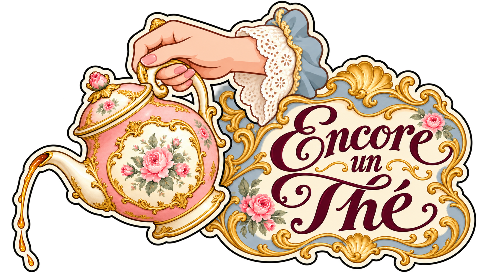
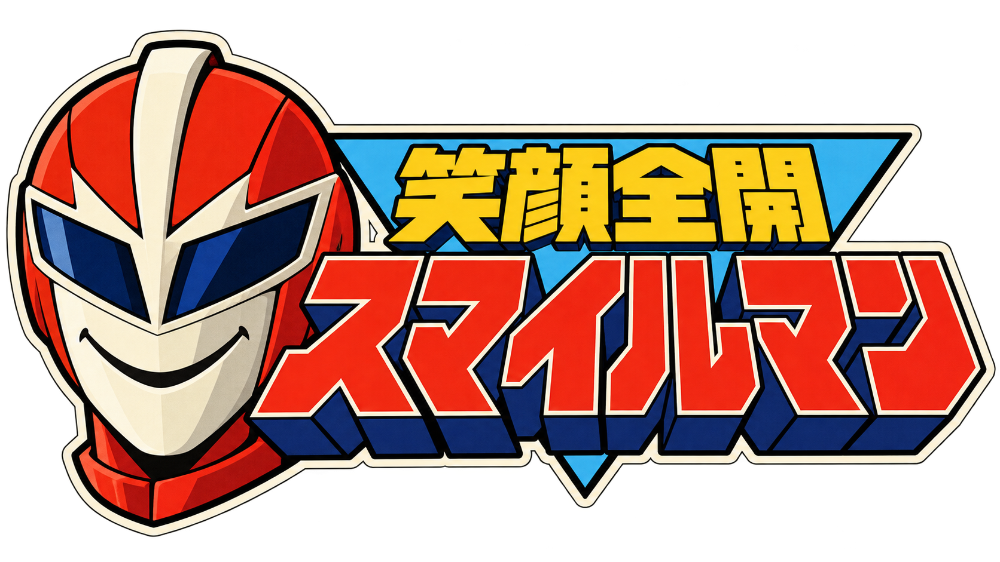
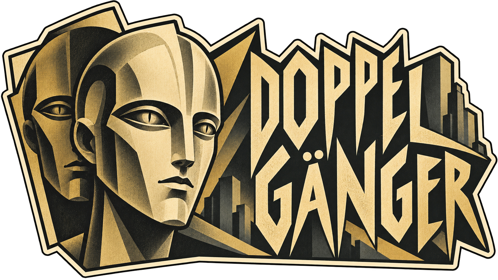
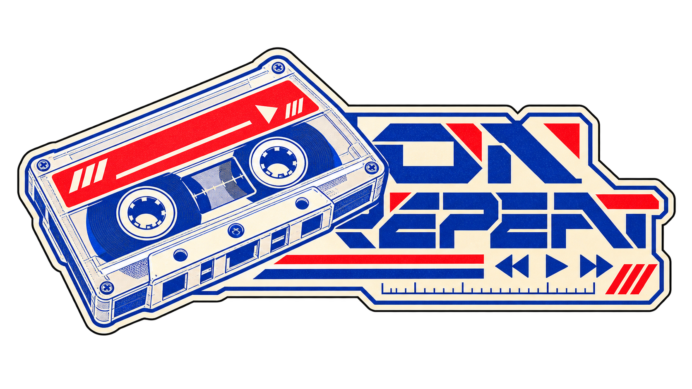

# 标签标准视觉参考

这些是本次用户确认定稿的精选视觉样例，来自项目正式源图的原样副本。用于校准完成度、主体与艺术字的关系及风格差异，不是通用模板，也不是玩法或配置事实源。

## 使用方式

先按新任务选择最相关的1–2张，实际打开图像，再写明借鉴的维度。新艺术方向仍须研究其自身来源，不把这些样例当成大师原作。不得默认复制样例文案、角色、配色或材质；用户新参考优先。源图是设计参考，生成边缘与线宽不构成原生像素验收标准，导出仍按目标项目现行规范单独核验。

## Encore un Thé · 洛可可曲线、花饰与书法

- 参考重点：手与茶壶构成完整左主体，右侧花框紧贴壶身；长短词通过字号层级组织。
- 使用边界：花饰密度不是所有标签的默认值；小尺寸须检查细线。
- 来源：`Assets/Game/Art/Stickers/Sources/StickerTeapotSource.png`，用户确认的定稿源图。
- SHA256：`c9d963043b6afe216c8a95f04dc94aabbaa657ddca8f694f515dc593b13ecfb4`。

## スマイルマン · 昭和特摄标题与角色

- 参考重点：大色块头盔、红色切角片假名、深蓝挤出层和黄色副标题形成清楚层级。
- 使用边界：不复制具体影视角色或原作标题；挤出厚度按新字形调整。
- 来源：`Assets/Game/Art/Stickers/Sources/StickerSmileMaskSource.png`，用户确认的定稿源图。
- SHA256：`06224ce447f16b9641a3550b71c19aba6b0c5a51b25fe11cb01ea92ebafc5bc9`。

## DOPPELGÄNGER · 表现主义与建筑式字形

- 参考重点：双面孔表达复写意象，黑金有限色板，尖角字形与背景建筑同一节奏。
- 使用边界：两张脸属于一个复合主体，不据此给其他标签堆叠主体。
- 来源：`Assets/Game/Art/Stickers/Sources/StickerCarbonSource.png`，用户确认的定稿源图。
- SHA256：`430b35e0fdadb50c50da62f43f603b0c1f245c0da71867c66631572fbb61450f`。

## ON REPEAT · 磁带未来主义与有限色印刷

- 参考重点：原创透明壳磁带配钴蓝线稿、鲜红色块和暖白；右侧切角技术字与播放符号呼应。
- 使用边界：主体与首字距离偏紧，新设计须额外保证完整字腔和小尺寸可读性，不照搬遮挡关系。
- 来源：`Assets/Game/Art/Stickers/Sources/StickerCassetteSource.png`，用户确认的定稿源图。
- SHA256：`5db020179f22ea978d4501e5e4cc76e3a2e09d37c5c1c449d0c6ad3793cfcfa9`。

